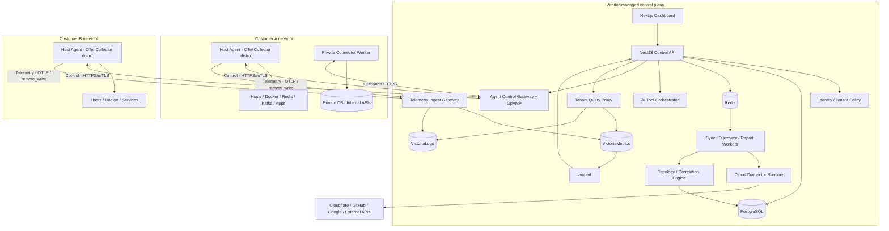
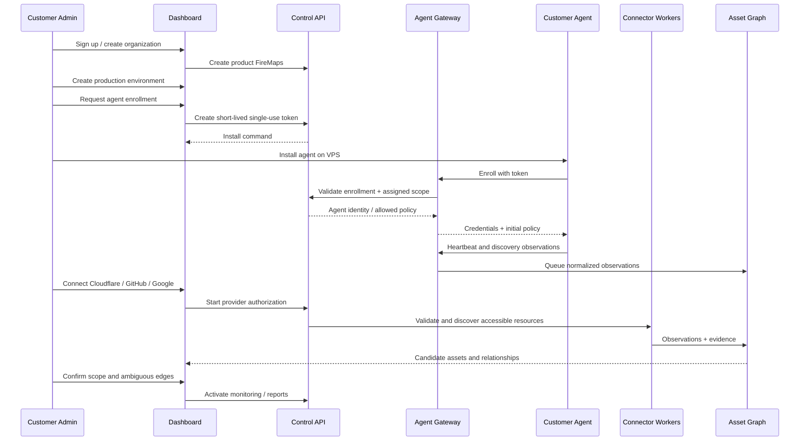
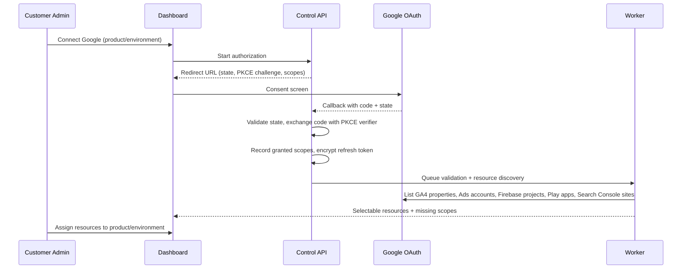
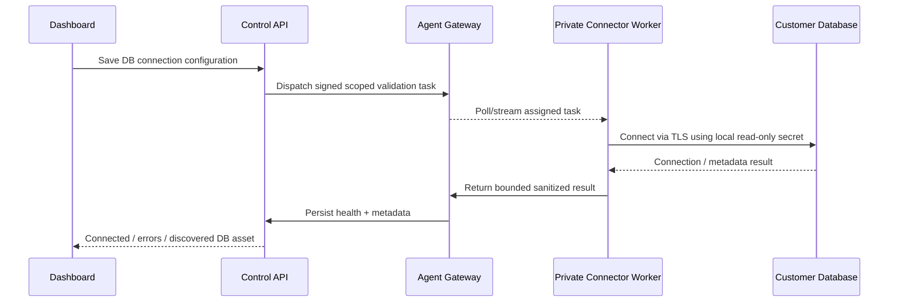
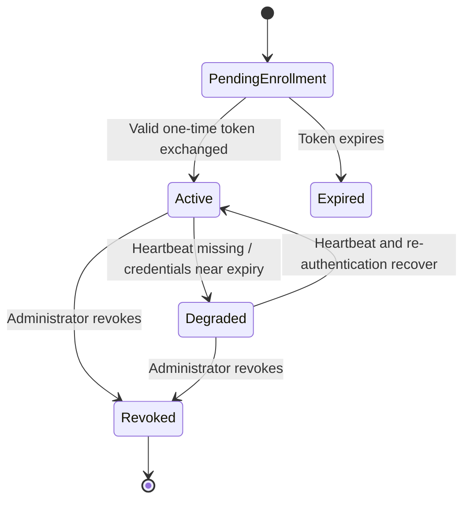
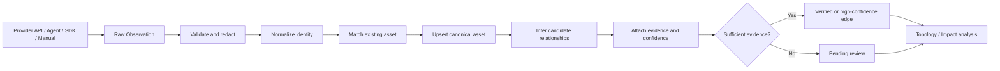
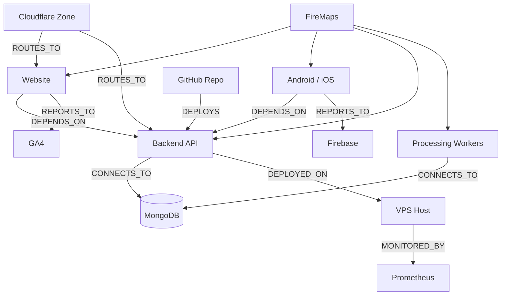
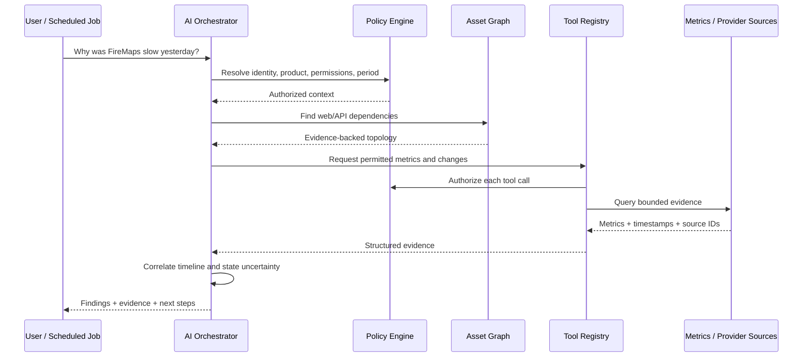
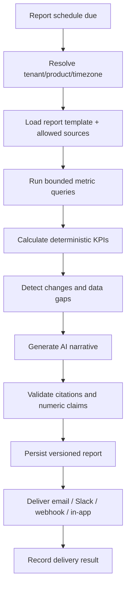
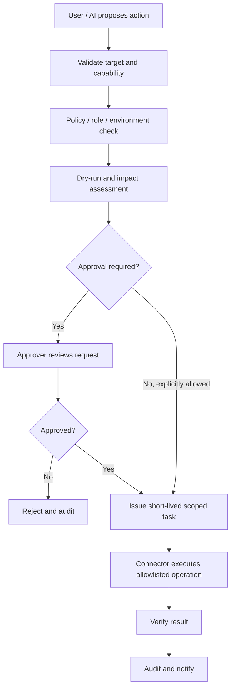

# AI Product Control Plane
## Final Multi-Tenant Architecture, Integration, Agent, Data, Security, and Operations Flow Specification

**Document status:** Architecture blueprint / implementation reference  
**Version:** 1.1  
**Date:** 2026-10-21  
**Primary deployment:** Multi-tenant managed SaaS with deployable customer agents  
**Secondary deployment:** Fully self-hosted enterprise control plane  
**Example product:** FireMaps (illustrative topology, not a claim about deployed infrastructure)  
**Change log:** 1.1 adds the Google OAuth connection flow and scope set (§7.2), fleet installation and monitoring packs (§8.7–8.10), host-level relationship evidence (§10.7), and the OpenTelemetry-based telemetry pipeline with tenant isolation, limits, retention, logs, data inspection, real-time delivery, and scale path (§11.4–11.13). It also adds installation methods and the installer runner (§8.11, §4.12) and reconciles inital.md: full connector capability set (§9), asset lifecycle states (§10.2), `DEPLOYS` edge type and verification states (§10.4), canonical AI tool names (§12.1), and schema naming (§14.1).

---

## 1. Executive Summary

Build a multi-tenant, AI-powered Product Operations Control Plane that connects to a customer's existing product ecosystem without requiring the customer to rebuild their product. The platform discovers authorized assets, correlates dependencies, monitors technical and business signals, investigates incidents, creates reports, and optionally performs tightly controlled operational actions.

The **product knowledge graph** is the core data model. AI is an interface and reasoning layer on top of verified tools and evidence, not the system of record.

### 1.1 Product goals

1. Support many independent organizations (tenants), each with multiple products and environments.
2. Install lightweight agents into customer networks to observe private resources without opening inbound ports.
3. Connect external SaaS platforms through OAuth, service accounts, API tokens, provider apps, and webhooks.
4. Automatically discover assets, record provenance, and correlate relationships with explicit confidence.
5. Monitor infrastructure, application, website, mobile, database, and business metrics.
6. Answer questions and create scheduled intelligence reports with citations to underlying operational evidence.
7. Support approved automation without unrestricted AI shell or database access.
8. Offer managed SaaS and full self-hosting from one architecture.

### 1.2 Non-goals for the initial release

- No promise to discover every dependency from a URL or installed agent alone.
- No arbitrary remote command execution, unrestricted SSH, or AI-generated production SQL.
- No replacement for Prometheus, Grafana, or specialized APM/analytics data stores.
- No unrestricted collection of private source code, secrets, customer records, or full database contents.
- No cross-tenant learning or data sharing without a separately designed, explicit consent mechanism.

### 1.3 Core vocabulary

| Concept | Meaning |
|---|---|
| Organization / tenant | Security and billing boundary belonging to a customer. |
| Product | Logical customer-owned application or service ecosystem, e.g. FireMaps. |
| Environment | Production, staging, development, or other isolated deployment context. |
| Asset | Canonical resource such as a domain, website, repository, VPS, database, SDK, or analytics property. |
| Connection | Authorized configuration linking the platform to a provider or data source. |
| Connector | Versioned implementation of provider-specific discovery, queries, events, and optional actions. |
| Agent | Customer-side runtime with authenticated identity and a narrow collection policy. |
| Private connector worker | Customer-side executor for APIs/databases that should remain private. |
| Observation | Time-stamped evidence about a discovered resource. |
| Relationship | Directed, evidence-backed link between assets. |
| Control plane | Central configuration, orchestration, policy, inventory, AI, and management services. |
| Data plane | Collectors, telemetry sources, provider APIs, and ingestion pipelines. |
| Action | Explicit, policy-constrained operational change. |
| Monitoring pack | Versioned bundle for one technology (e.g. Redis): detection rules, collector configuration, required credentials, default alerts, dashboard panels, and graph mappings. |
| Control channel | Low-volume, reliable agent link for enrollment, heartbeats, configuration (OpAMP), tasks, and actions. |
| Telemetry channel | High-volume agent link for metrics, logs, and traces using OTLP and Prometheus remote_write. |

---

## 2. Multi-Tenant Ownership Model

```text
Platform
├── Organization A: Example Company
│   ├── Product: FireMaps
│   │   ├── Environment: Production
│   │   │   ├── Cloudflare connection (scoped zones)
│   │   │   ├── GitHub App connection (selected repositories)
│   │   │   ├── GA4 property connection
│   │   │   ├── Firebase project connection
│   │   │   ├── Google Ads account connection
│   │   │   ├── Prometheus connection
│   │   │   ├── Agent: regional API VPS
│   │   │   ├── Agent: processing VPS
│   │   │   ├── Private database connector
│   │   │   └── Web/mobile telemetry SDK sources
│   │   └── Environment: Staging
│   │       └── Agent: staging VPS
│   └── Product: Other App
│       └── Environment: Production
├── Organization B: Online Store
│   └── Product: Storefront
│       └── Environment: Production
└── Organization C: Enterprise
    └── Dedicated self-hosted deployment
```

**Critical rules:**

- `organization_id` is the primary authorization boundary; `product_id` and `environment_id` further restrict scope.
- A provider connection may be owned by an organization and explicitly assigned to selected products/resources; never automatically expose all provider resources to every product.
- A single physical host can contain workloads from multiple products. The collector's authorized resource scope is separate from host ownership; do not assume one agent equals one product.
- Shared assets can be represented once at the appropriate organizational scope and associated with multiple products through explicit ownership/membership links. Cross-organization sharing requires a separate permission model and is out of MVP scope.
- Tenant identity is always derived from authenticated server-side context, never accepted solely from a request body or agent payload.

### 2.1 Roles and permissions

| Role | View | Configure connections | Manage policies | Approve actions | Manage members |
|---|---|---|---|---|---|
| Owner | Yes | Yes | Yes | Yes | Yes |
| Admin | Yes | Yes | Yes | Policy-dependent | Yes |
| Operator | Yes | Limited | Limited | Policy-dependent | No |
| Analyst | Yes, scoped | No | No | No | No |
| Viewer | Read-only | No | No | No | No |

Enforce permissions on every API endpoint, worker task, connector operation, graph traversal, report, export, AI tool call, and agent command. UI hiding is not authorization.

---

## 3. Deployment Models

### 3.1 Model A: Managed multi-tenant SaaS (recommended first)



The customer installs only necessary collectors and private connectors. Central SaaS handles identity, UI, graph, jobs, reports, and provider connectors authorized to execute centrally. Control and telemetry traffic use separate endpoints so each scales and fails independently.

### 3.2 Model B: Fully self-hosted enterprise

Deploy web, API, workers, PostgreSQL, Redis, gateway, and optional local model endpoint in the customer's environment. Host agents connect to the enterprise gateway, and external APIs are reached according to customer egress policy. The same tenant and product model remains valid even when a single organization uses the deployment.

### 3.3 Model C: Hybrid / dedicated control plane (later)

Vendor-managed software updates with dedicated per-customer storage and compute, or customer-hosted private connector runtimes with centralized metadata. Treat this as a separate supported topology with explicit data residency, support access, and network trust policies.

### 3.4 Deployment mode comparison

| Concern | Managed SaaS | Fully self-hosted |
|---|---|---|
| Control plane operator | Vendor | Customer |
| Primary operational DB | Vendor | Customer |
| Private host agents | Customer network | Customer network |
| External OAuth callback | Vendor domain | Customer domain |
| Encryption root key | Vendor-managed external secret | Customer-managed secret |
| Upgrades | Vendor | Customer-controlled |
| LLM processing | Configurable vendor/provider | Configurable private/provider |
| Isolation | Shared multi-tenant with defense in depth | Dedicated installation |

---

## 4. System Components and Responsibilities

### 4.1 Frontend: Next.js dashboard

Screens: organizations, products, environments, onboarding, integrations, credentials status, agent fleet, asset inventory, topology, infrastructure, websites, mobile apps, analytics, databases, incidents, AI assistant, reports, automations, approvals, audit, users, settings. Use server-driven pagination, RBAC-aware views, optimistic UX only for reversible non-critical changes, and SSE/WebSocket updates for operational status.

### 4.2 Control API: NestJS + Fastify

Modules: identity, tenants, products, environments, connections, connector catalog, agents, discovery, assets, topology, telemetry query, incidents, AI, schedules, reports, actions, notifications, auditing. Owns authorization and persistence, but delegates long-running work to queues.

### 4.3 Worker runtime: BullMQ + Redis

Executes connection validation, discovery, synchronization, metric aggregation, graph reconciliation, incident evaluation, reports, notifications, and bounded AI investigations. PostgreSQL stores durable job definitions and execution history; Redis coordinates queues and retries. Reconcile recurring schedules at startup and after configuration changes. Use distributed locks, idempotency keys, and dead-letter handling.

### 4.4 Agent control gateway

Separate logical gateway (initially can be a module/deployment of NestJS) authenticates agents, handles enrollment, heartbeats, polling/streamed tasks, OpAMP configuration delivery, protocol versions, backpressure, and per-agent quotas. It carries only the low-volume control channel; telemetry goes to the telemetry ingest gateway (§4.10). It does not trust agent-supplied tenant identifiers.

### 4.5 Host agent (OpenTelemetry Collector distribution)

The host agent is a custom OpenTelemetry Collector distribution written in Go and compiled with OpenTelemetry Collector Builder (`ocb`). It includes only the receivers, processors, and exporters the supported monitoring packs need (§8.8), plus three product-specific extensions:

- **Enrollment extension:** exchanges the one-time enrollment token for a per-agent identity and rotates credentials.
- **Discovery extension:** reports permitted host facts (OS, systemd units, listening ports, Docker containers, and established connections when enabled) as observations.
- **Inspector extension:** runs allowlisted, read-only data-inspection commands (§11.9) and on-demand log tails (§11.8).

A small OpAMP supervisor process manages the collector: it receives remote configuration, reports effective configuration and health, and performs signed upgrades. The agent defaults to outbound-only networking and runs as the unprivileged `pcp-agent` user. Optional collectors for process metadata, Docker inventory, logs, and sensitive host information must be separately enabled. Do not mount the Docker socket or host root filesystem by default.

Every receiver adds binary size and memory. Keep the component list minimal, set `memory_limiter` on every pipeline, and measure footprint for each release.

### 4.6 Private connector worker

A customer-network worker, initially TypeScript, runs shared connector SDK modules for private PostgreSQL, MongoDB, MySQL, Prometheus, Grafana, and internal HTTP APIs. It uses restricted credentials, validates signed tasks, and returns bounded summaries, not unrestricted raw data. Can be colocated with a host agent but remains a separate security capability.

### 4.7 Integration connector runtime

Runs provider-specific adapters with capability declarations. Cloud connectors access Google, GitHub, Cloudflare, etc. Private connectors execute inside customer networks. Credentials should reside at the execution location wherever practical; centrally held tokens must be encrypted and least-privileged.

### 4.8 Asset graph / discovery engine

Consumes observations from connectors, agents, telemetry, and manual entry. Deduplicates assets, records evidence, proposes edges, verifies known relationships, and supports impact analysis. Store graph edges in PostgreSQL first.

### 4.9 AI orchestration engine

Uses tenant-scoped tools over the graph, metrics, incidents, and reports. Model never receives raw secrets or arbitrary network access. Numeric computation, permissions, and source selection occur outside the model. Proposed actions flow through policy/approval services.

### 4.10 Telemetry ingest gateway

Stateless, horizontally scaled service that receives OTLP (metrics, logs, traces) and Prometheus remote_write from host agents, application SDKs, and customer OpenTelemetry collectors. It authenticates the sender, resolves organization/product/environment from the authenticated identity, overwrites any tenant labels or headers supplied by the sender, applies per-tenant rate and active-series limits (§11.6), and forwards to storage. It never trusts tenant identity from the payload.

### 4.11 Telemetry storage, alerting, and query

- **Metrics:** VictoriaMetrics, single node for MVP and cluster at scale (§11.12).
- **Logs:** VictoriaLogs for opt-in retained logs; live tail needs no storage (§11.8).
- **Traces:** customer backends first; hosted Tempo later.
- **Alerting:** vmalert evaluates per-tenant rules next to the data and notifies the control API.
- **Tenant query proxy:** every read from the API, AI tools, reports, and dashboard passes through a proxy that enforces tenant and product scope (§11.5). No other component queries telemetry storage directly.

Customer-owned Prometheus remains supported through the Prometheus connector (Mode A, §11.4).

### 4.12 Installer runner (opt-in)

Isolated Go worker that performs assisted SSH installs (§8.11). It has no database access beyond its own `install_sessions` records, holds no stored credentials, runs installs in parallel across a fleet, and egresses only from fixed IPs.

---

## 5. Recommended Technology Stack

| Layer | Technology | Notes |
|---|---|---|
| Monorepo | pnpm workspaces + Turborepo | Shared contracts, SDKs, builds |
| Web | Next.js, React, TypeScript | App Router |
| UI | Tailwind, shadcn/ui, TanStack Query | React Flow for graph, Recharts for charts |
| API | NestJS + Fastify | REST/OpenAPI, SSE for updates |
| DB | PostgreSQL + Prisma | RLS and carefully reviewed migrations |
| Jobs | BullMQ + Redis | Schedules persisted in PostgreSQL |
| Host agent | Go: OpenTelemetry Collector distribution built with `ocb` | Plus enrollment, discovery, and inspector extensions; static binaries and minimal images |
| Fleet management | OpAMP | Remote configuration, health, upgrades |
| Private connector | TypeScript/Node.js | Shared connector SDK |
| Telemetry protocols | OTLP + Prometheus remote_write | No custom telemetry wire format |
| Metrics storage | VictoriaMetrics (single node, then cluster); customer Prometheus via connector | Avoid high-cardinality metrics in PostgreSQL |
| Alert evaluation | vmalert | Rules compiled per tenant from `alert_rules` |
| Logs | On-demand live tail; opt-in VictoriaLogs; existing Loki/ELK via connector | Label-indexed, not full-text indexed |
| Traces | OpenTelemetry; hosted Tempo later | Tail sampling at the collector |
| Object storage | S3-compatible (S3, R2, MinIO) | Backups (`vmbackup`), report artifacts |
| AI | Provider-agnostic tool calling | OpenAI/Anthropic/compatible endpoint |
| Auth | Secure session auth + OIDC support | SSO later; MFA for privileged roles |
| Proxy | Caddy | TLS and reverse proxy |
| Deployment | Docker Compose | Kubernetes only when scale requires |
| Secrets | Envelope encryption with external root key | Vault/KMS optional or required at scale |
| Testing | Vitest/Jest, Playwright, Testcontainers | Provider contract tests |

---

## 6. Complete Customer Onboarding Flow



### 6.1 Account and organization

Create organization, verified admin, default roles, plan/quotas, timezone, data retention, and security settings. Audit first administrator creation. Invite members using expiring invitations.

### 6.2 Product creation

Create product name, description, ownership, environments, known domains, GitHub repositories, and optional service map. Domains are discovery hints, not proof of ownership. Require verification/authorization before probing or managing external resources.

### 6.3 Integration selection

Present connection options by category: cloud/SaaS, infrastructure, database, website/app telemetry, custom API, and webhook. Show exact requested permissions, execution location, data collected, collection frequency, and whether changes are supported.

### 6.4 Agent enrollment

Admin creates an enrollment request with organization, product/environment assignment, agent type, capability policy, expiration, and maximum uses. Token is displayed once and stored hashed. On enrollment, exchange token for a unique revocable identity; rotate credentials periodically. Never use the enrollment token as a permanent agent API key.

### 6.5 First discovery and verification

Show discovered assets with source, timestamp, confidence, and ownership scope. Present ambiguous correlations for approval. Activate monitoring only for selected assets. Maintain a visible coverage report: connected, discovered, verified, missing telemetry, stale, and inaccessible.

---

## 7. Connection Patterns and Where They Run

There are three major channels: **cloud provider connectors**, **customer-network agents/private connector workers**, and **application SDKs/webhooks**.

| Resource | Protocol/auth | Runtime | Direction | Typical outputs |
|---|---|---|---|---|
| Cloudflare | Scoped REST API token | Central or private | Pull + webhooks where available | Zones, DNS, analytics, changes |
| GitHub | GitHub App installation | Central | Pull + signed webhooks | Repos, deployments, workflow events |
| GA4 | OAuth or property-authorized service account | Central/private | Pull | Sessions, events, traffic |
| Firebase | Service-specific Google APIs and credentials | Central/private | Pull/export | Project metadata, supported telemetry |
| Google Ads | OAuth + developer token | Central/private | Pull | Spend, campaigns, conversions |
| VPS | Mutual-auth agent identity | Customer network | Outbound control + OTLP/remote_write | Host metadata, metrics, service inventory |
| Docker | Read-only socket proxy (opt-in) | Customer network | Local query then push | Container metadata, health, resource use |
| Redis | Read-only ACL user | Host agent pack | Local query then push | Memory, ops, hit ratio, replication, queue depths |
| Kafka | SASL user with Describe ACLs | Host agent pack | Local query then push | Consumer lag, partitions, topic throughput |
| Node.js / backend apps | Process metrics; optional OTel SDK or `/metrics` | Host agent pack | Local scrape/OTLP then push | Process health, RED metrics, logs |
| PostgreSQL | TLS + read-only database user | Private worker | Private query | Health, approved aggregates |
| MongoDB | TLS + read-only database user | Private worker | Private query | Metadata, approved aggregates |
| Prometheus | Authenticated HTTP API | Central or private | Pull | Instant/range metrics, targets |
| Grafana | Service account token | Central or private | Pull | Dashboards, metadata |
| Website | HTTPS probes + optional JS SDK | Central + browser | Pull + push | Uptime, latency, web vitals |
| Mobile app | Instrumentation SDK / Firebase | Device + provider | Push / provider pull | Versions, crashes, analytics |
| Custom API | API key/OAuth/mTLS | Central or private | Pull | Mapped resources and metrics |
| Webhooks | HTTPS + signature + replay checks | Control API | Push | Events, changes, incidents |

### 7.1 Cloud connector connection flow

1. User selects connector and execution location.
2. UI fetches connector's schema and capabilities.
3. User provides required configuration and authorizes access.
4. Backend validates OAuth state/PKCE where applicable, or validates a scoped API token.
5. Encrypt and store credentials; never echo tokens back to browser.
6. Create connection with tenant/resource scope and status `pending_validation`.
7. Queue validation; fetch accessible resources and display selectable scope.
8. User explicitly selects relevant resources and associates them with products/environments.
9. Queue discovery and scheduled synchronization.
10. Persist observations, metrics, and health; record quota/rate-limit failures.
11. Refresh/rotate credentials according to provider mechanisms and report disconnections.

### 7.2 Google authorization

Login and data access are separate steps:

- **Sign in with Google** requests only `openid email profile`. It establishes identity and grants no data access.
- **Connect Google** runs later, per product/environment, and requests the data scopes in §7.2.2.

Do not create or download service-account JSON keys for customers. Key creation is commonly blocked by organization policy (`iam.disableServiceAccountKeyCreation` is enforced by default in newer Google Cloud organizations), needs near-admin `cloud-platform` access, and produces a long-lived secret that stays valid until someone deletes it. The OAuth refresh token is the credential.

There is no universal Firebase endpoint for every Firebase feature; each Google service is reached through its own supported API, and scopes, quotas, and approvals are connector-specific.

#### 7.2.1 OAuth connection flow



1. Use the authorization code flow with PKCE and a `state` value bound to the user session. Set `access_type=offline` and `prompt=consent` so Google returns a refresh token, and `include_granted_scopes=true` for incremental authorization.
2. Request the read scope set (§7.2.2) on the Connect step, never on login.
3. On callback, validate `state`, exchange the code with the PKCE verifier, and store the refresh token encrypted in `connection_secrets`. Never return tokens to the browser.
4. Read the `scope` field of the token response. Google's granular consent lets users untick individual scopes. Store granted scopes in `connection_granted_scopes`, mark each service whose scope is missing as `permission_denied`, and offer a "grant missing access" button that re-runs incremental authorization.
5. Discover accessible resources. The user assigns each resource to a product/environment (`connection_resource_scopes`).
6. Workers exchange the refresh token for short-lived access tokens per sync. On `invalid_grant`, set the connection to `reauthorization_required`, stop sync, keep historical data, and notify the owner.

#### 7.2.2 Scope set (full read access)

All scopes are prefixed `https://www.googleapis.com/auth/`.

| Scope | Service | Data |
|---|---|---|
| `analytics.readonly` | GA4 Admin and Data APIs | Properties, streams, reports, realtime, events, audiences |
| `analytics.manage.users.readonly` | GA4 Admin API | Access bindings per property |
| `adwords` | Google Ads API | Accounts, campaigns, spend, clicks, impressions, conversions, keywords |
| `firebase.readonly` | Firebase Management API | Projects, apps, linked GA4 properties |
| `cloud-platform.read-only` | Google Cloud APIs that accept it | Project metadata, enabled services, IAM view |
| `monitoring.read` | Cloud Monitoring | Firebase and Google Cloud metrics |
| `logging.read` | Cloud Logging | Project logs |
| `bigquery.readonly` | BigQuery | Crashlytics, Performance Monitoring, and GA4 raw-event exports |
| `playdeveloperreporting` | Play Developer Reporting API | Android vitals: crash rate, ANR rate, per version |
| `webmasters.readonly` | Search Console API | Search queries, indexing, coverage |
| `tagmanager.readonly` | Tag Manager API | Containers and tags (optional) |

Notes:

- `adwords` is the only Google Ads API scope and permits writes. The connector enforces read-only by never issuing mutate operations, and a contract test verifies this. The Ads connector also needs the platform's developer token (Basic or Standard access) and `login-customer-id` when access goes through a manager account. Service accounts are not a general substitute for this OAuth flow.
- Crashlytics, Performance Monitoring, and GA4 raw events are read from BigQuery only after the customer enables the corresponding export.
- Firebase Authentication user records are not read through OAuth, because that requires the write-capable `cloud-platform` scope. Use the Admin SDK inside the private connector worker with customer credentials, or application instrumentation. Historical authentication activity requires explicit instrumentation or export. Never report GA4 `login` events as verified authentication counts.
- iOS store and crash metrics outside Crashlytics need an App Store Connect connector (Apple API key), not Google.
- PageSpeed Insights and the Chrome UX Report use an API key, not OAuth.
- Many scopes on one consent screen lower completion and lengthen Google's review. Keep the set read-only and explain each scope on the Connect screen.

#### 7.2.3 Keyless service-account mode

For enterprises that do not want a personal OAuth grant:

- The customer grants a platform-owned service account email access to their resources (for example GA4 Viewer, or read roles on a project). No key file leaves Google.
- Use one platform service account per tenant, or verify the tenant's ownership of every resource ID before each call. With one shared service account, a tenant could submit another tenant's property ID and read it (confused deputy).
- In self-hosted deployments, the customer's own service account or Workload Identity Federation runs inside the private connector worker.

#### 7.2.4 Google approvals

Sensitive scopes require OAuth app verification. Before verification the app is limited to 100 users, and while the app is in Testing mode refresh tokens expire after 7 days. Google Ads developer-token approval is a separate review. Start both early; they can block milestones (§23).

### 7.3 Private database connection flow



**Preferred security:** Customer stores DB credentials in the private connector's secret store; control plane stores an opaque secret reference and non-sensitive configuration. If cloud-side credentials are unavoidable, encrypt them with an externally supplied key and prohibit arbitrary queries.

### 7.4 Website connection flow

- Verify customer control of domain or obtain authorized monitoring scope.
- Register URL, probe locations, intervals, expected status, redirects, and TLS checks.
- Perform synthetic HTTP checks centrally or from selected private collectors.
- Optionally add browser telemetry SDK for web vitals, JS errors, session events, and correlation IDs.
- Optionally instrument backend using OpenTelemetry for traces and service dependencies.
- Connect deployments through GitHub/CI provider rather than inferring all infrastructure from HTML.

### 7.5 Mobile application connection flow

- Register app identity, platform, bundle/package ID, and environment.
- Connect Firebase/analytics/crash sources as authorized.
- Optionally integrate a lightweight telemetry SDK for missing signals; support batching, offline buffering, consent/privacy requirements, and release tagging.
- Correlate backend API calls through trace IDs or explicitly configured service mappings.
- Mobile SDK should never embed administrative provider credentials or tenant secrets.

### 7.6 Custom REST integration flow

Configuration: base URL, authentication reference, allowlisted endpoints, method, query params, pagination, timeout, retry, JSONPath-like extraction mapping, schedule, and sensitivity classification. Validate DNS/IP after redirects and block loopback/link-local/private metadata destinations unless explicitly allowed for a customer-side private connector. Prevent SSRF and data exfiltration.

### 7.7 Webhook ingestion flow

Provider event -> HTTPS endpoint -> verify signature/timestamp -> replay/idempotency check -> tenant/connection lookup -> schema validation -> durable queue -> normalization -> asset/incident update -> optional notification. Persist delivery metadata, not necessarily entire sensitive payload. Use per-connection secrets and retention rules.

---

## 8. Agent Design in Depth

### 8.1 Agent types

1. **Host agent (Go):** Low-overhead host, process, service, and optional Docker discovery.
2. **Private connector worker (TypeScript):** Database/API access and bounded queries within customer network.
3. **Application instrumentation:** Browser/mobile SDK and OpenTelemetry collectors; these are telemetry producers, not administrative agents.

### 8.2 Enrollment and identity lifecycle



Use short-lived enrollment token, device/agent identity, scoped credentials, key rotation, certificate or key revocation, and signed policy versions. Bind agent to allowed product/environment/resource scopes. Consider mTLS for stronger deployments. Enforce agent software version compatibility and reject unsupported protocol versions.

### 8.3 Heartbeat

Recommended fields: agent ID, protocol version, software version, capabilities, last successful collection, health, queue depth, timestamp, policy version. Authenticate transport; gateway attaches trusted tenant scope. Use clock-skew tolerance and monotonic message sequencing or dedupe IDs.

### 8.4 Task dispatch

For outbound-only networking, the agent opens a long-lived authenticated stream or polls `/agent/tasks`. Tasks are created centrally but can only execute if permitted by both centrally signed policy and local agent configuration. Include task ID, expiration, connector capability, resource scope, max runtime, response size, and approval reference for actions.

Persistent configuration (enabled packs, scrape intervals, filters) is delivered through OpAMP. One-off, time-bounded operations (live boost, log tail, data inspection, actions) are tasks with a TTL; the agent reverts or stops them on TTL expiry even when disconnected from the control plane.

### 8.5 Offline behavior

- Buffer bounded batches locally. The telemetry channel uses the collector's persistent queues (`file_storage`, remote_write WAL). The collector does not encrypt them, so place `/var/lib/pcp-agent` on an encrypted volume where policy requires encryption at rest.
- Use exponential backoff and jitter.
- Drop or aggregate low-priority metrics when disk quota is exceeded; never silently drop security-relevant audit records without surfacing an error.
- Acknowledge successful batches and retry with stable message IDs.
- Mark agent stale in dashboard after missed heartbeats.
- Do not execute expired or previously revoked operational tasks after reconnecting.

### 8.6 Collector safety

No arbitrary shell, no automatic secret scraping, no default Docker socket mount, no privileged container, no full host filesystem mount. Use read-only proc/sys mounts only if justified and documented. For management actions, deploy a separate highly restricted executor or opt-in capability with explicit allowlists and approval. Exporters bind to `127.0.0.1` only; the discovery extension warns about any exporter already listening on a public interface.

### 8.7 Fleet installation

```bash
curl -fsSL https://ops.example.com/install.sh | sudo bash -s -- \
  --token ENROLLMENT_TOKEN --environment production --packs host,redis,nodejs
```

- One enrollment token can cover a fleet: set `max_uses` to the number of hosts and a short expiry. Each host still exchanges the token for its own unique identity (§8.2).
- The installer verifies the agent binary signature and checksum, then creates the unprivileged `pcp-agent` user, a systemd unit, `/etc/pcp-agent/` for configuration and secrets, and `/var/lib/pcp-agent/` for state and persistent telemetry queues.
- Publish the installer at a versioned URL with a checksum so customers can download and inspect it before running it.
- For larger fleets, run the same installer from Ansible, cloud-init, or a baked image. Docker hosts can use the hardened Compose agent profile (§17.2).
- `--packs` selects packs at install time. `--enable-pack-installer` additionally installs the privileged pack installer needed for remote Level 1 packs (§8.9). It is off by default.

### 8.8 Monitoring packs

A monitoring pack is a versioned manifest for one technology. Enabling a pack on an agent compiles its collector configuration into the agent's OpAMP configuration, creates default alert rules, registers dashboard panels, and maps discovered services into the asset graph.

Example manifest (illustrative):

```yaml
id: redis
version: 1.0.0
detect:
  - process: redis-server
  - port: 6379
change_level: 0
credentials:
  - name: redis_monitor
    hint: Redis ACL user limited to monitoring commands (§8.10)
collector:
  receivers:
    redis:
      endpoint: 127.0.0.1:6379
      collection_interval: 30s
optional_managed_exporter: redis_exporter   # only for key-length checks
metric_allowlist: [redis.*]
alerts:
  - id: redis-evictions
    description: Keys evicted in the last 10 minutes
    severity: warning
  - id: redis-memory-high
    description: Memory above 85% of maxmemory for 10 minutes
    severity: warning
graph:
  asset_type: redis_instance
  edges: [{ type: HOSTS, from: host }]
inspection:
  allowed_commands: [INFO, DBSIZE, SLOWLOG GET, LATENCY LATEST, CLIENT LIST, MEMORY STATS]
```

Initial pack catalog:

| Pack | Collector | Change level | Credentials | Key default alerts |
|---|---|---|---|---|
| host | `hostmetrics` receiver | 0 | None | Disk full forecast < 24 h, memory > 90% for 10 min, systemd unit failed |
| docker | `docker_stats` receiver through a read-only socket proxy | 0 (opt-in) | None | Container restart loop, unhealthy container |
| redis | `redis` receiver; optional `redis_exporter` for key-length checks | 0 (exporter: 1) | Read-only ACL user | Evictions > 0, memory > 85% of `maxmemory`, replication link down |
| kafka | `kafkametrics` receiver (brokers, topics, consumer groups) | 0 | SASL user with Describe ACLs | Offline partitions > 0, under-replicated partitions, consumer lag rising for 15 min |
| kafka-jvm | JMX exporter Java agent on the broker | 2 (broker restart) | None | Request latency, ISR shrink rate, heap and GC pressure |
| nodejs | Process metrics, PM2/systemd state, HTTP health probe; optional `/metrics` or OTLP | 0 (deep metrics: 2) | None | Restart loop, health check failing, event-loop lag > 200 ms, 5xx rate above baseline |
| nginx | `nginx` receiver (`stub_status`) and access-log parsing | 2 (enable `stub_status`) | None | 5xx rate, upstream latency |
| postgresql / mongodb / mysql | Matching OTel receiver | 0 | Read-only database user | Connection saturation, replication lag, storage growth |
| http-check | `httpcheck` receiver | 0 | None | Endpoint down, latency above threshold |

Detection: the discovery extension matches process names, command lines (for example `kafka.Kafka`), listening ports, systemd units, and container images against pack `detect` rules. The dashboard then proposes packs per host, for example "api-vps-01: Redis 7, Node.js (PM2, 3 apps), Nginx — enable packs?". Nothing is collected until a user enables the pack.

If a customer already runs exporters (`node_exporter`, `redis_exporter`, `kafka_exporter`), the agent scrapes them on localhost with the `prometheus` receiver instead of duplicating collection.

### 8.9 Change levels and privileges

| Level | Meaning | Performed by | Control |
|---|---|---|---|
| 0 — observe | Built-in receivers, host metrics, health probes; no change to customer software | Agent, through OpAMP configuration | Admin/Operator enables the pack; audited |
| 1 — managed exporter | Agent installs a signed, version-pinned exporter as a separate systemd unit bound to `127.0.0.1` | Privileged pack installer | Action flow with approval (§13.5); removable with `pack remove` |
| 2 — customer change | Needs a restart, configuration change, or code change (JVM agent, `stub_status`, OTel SDK) | Customer only | Platform shows guided instructions and verifies that metrics arrive; never performed automatically |

Example Level 2 instruction for Node.js deep metrics:

```bash
npm install @opentelemetry/api @opentelemetry/auto-instrumentations-node
NODE_OPTIONS="--require @opentelemetry/auto-instrumentations-node/register" \
OTEL_SERVICE_NAME=firemaps-api \
OTEL_EXPORTER_OTLP_ENDPOINT=http://127.0.0.1:4318 \
OTEL_METRICS_EXPORTER=otlp \
node server.js
```

MVP: the agent runs unprivileged, and Level 1 packs are chosen at install time (`--packs`). Remote Level 1 installation through the privileged pack installer is a later, opt-in feature (§26).

### 8.10 Pack credentials

The agent never reads application config files, `.env` files, the Redis `requirepass` setting, or Kafka JAAS files to obtain credentials. Credentials come only from what an administrator supplies:

- **Local file (preferred):** the admin writes `/etc/pcp-agent/secrets/<pack>.yaml` (mode `0600`, owner `pcp-agent`).
- **Dashboard entry:** the browser encrypts the credential to the agent's public key (sealed box) before sending. The control plane relays ciphertext it cannot decrypt and does not retain it after delivery. The agent decrypts and stores it locally.

Minimal monitoring users (illustrative; adjust to the customer's versions and policies):

```text
# Redis: monitoring commands only, no key access
ACL SETUSER pcp-monitor on >STRONG_PASSWORD resetkeys -@all +ping +info +dbsize +client|list +slowlog|get +latency|latest +memory|stats +config|get

# Redis: add only when queue-depth inspection is enabled, limited to allowlisted keys
ACL SETUSER pcp-monitor ~queue:* +llen +xlen +scard +zcard +memory|usage

# Kafka: metadata and consumer lag
Describe on Cluster; Describe on Topic '*'; Describe on Group '*'
# Kafka: add Read on specific topics only when message peek is enabled
```

### 8.11 Installation methods

The platform never stores root passwords and never keeps permanent SSH access. After installation, all management (upgrades, packs, configuration) runs over the outbound agent channel.

| Method | Who runs it | Credentials reach platform? | Availability |
|---|---|---|---|
| Self-install one-liner (§8.7) | Customer, in their own SSH session | No | MVP |
| Fleet tooling: Ansible role, cloud-init snippet, Docker Compose agent profile | Customer, in their own tooling | No | MVP |
| Cloud remote-run: AWS SSM Run Command, GCP OS Config, Azure VM Run Command | Platform, through a scoped role the customer grants | No (scoped cloud role only) | Later |
| Assisted SSH install | Platform installer runner, opt-in | Ephemeral key, destroyed after install | Opt-in |

**Assisted SSH install rules:**

1. The platform generates a one-time ed25519 key pair per install session. The customer adds the public key to a temporary `pcp-install` user with sudo. A password is accepted only as a last resort, held in memory only, used once, never stored, and the customer is told to rotate it.
2. The dashboard shows the server's host-key fingerprint, and the customer confirms it before the runner proceeds.
3. The runner executes only the fixed, signed install script. It offers no shell and runs no arbitrary command. Output streams to the dashboard.
4. After install, the runner removes its key and the `pcp-install` user, disconnects, and destroys the private key.
5. The runner connects only from fixed, published egress IPs, so the customer can allowlist them temporarily.
6. Every session is audited: initiator, host, fingerprint, script version, output, result, and cleanup confirmation.

---

## 9. Canonical Integration SDK Contract

```typescript
export type ConnectorCapability =
  | 'authenticate'
  | 'config_validation'
  | 'validate'
  | 'discover'
  | 'sync'
  | 'health'
  | 'metrics'
  | 'events'
  | 'webhook_registration'
  | 'credential_refresh'
  | 'actions';

export interface ExecutionContext {
  authenticatedOrganizationId: string;
  productId?: string;
  environmentId?: string;
  connectionId: string;
  executionLocation: 'cloud' | 'private';
  requestId: string;
  deadline: string;
}

export interface Connector {
  readonly type: string;
  readonly version: string;
  capabilities(): ConnectorCapability[];
  configSchema(): ZodTypeAny;
  validateConfig?(config: unknown): ConfigValidation;                                              // config_validation
  beginAuthorization?(ctx: ExecutionContext, input: AuthorizationRequest): Promise<AuthorizationRedirect>; // authenticate
  completeAuthorization?(ctx: ExecutionContext, input: AuthorizationCallback): Promise<CredentialGrant>;   // authenticate
  validate(ctx: ExecutionContext): Promise<ConnectionValidation>;                                  // validate
  discover?(ctx: ExecutionContext, cursor?: string): Promise<DiscoveryPage>;                       // discover
  sync?(ctx: ExecutionContext, cursor?: string): Promise<SyncPage>;                                // sync
  health?(ctx: ExecutionContext): Promise<HealthResult>;                                           // health
  collect?(ctx: ExecutionContext, query: MetricQuery): Promise<MetricBatch>;                       // metrics
  ingestEvent?(ctx: ExecutionContext, event: InboundEvent): Promise<NormalizedEvent[]>;            // events
  registerWebhook?(ctx: ExecutionContext): Promise<WebhookRegistration>;                           // webhook_registration
  refreshCredential?(ctx: ExecutionContext): Promise<CredentialRefreshResult>;                     // credential_refresh
  executeAction?(ctx: ExecutionContext, action: ApprovedAction): Promise<ActionResult>;            // actions
}
```

A connector declares a capability if and only if it implements the matching method; the registry rejects connectors where the two disagree.

Connector implementations must not trust tenant IDs from client payloads. The runtime loads a connection by ID only after verifying the authenticated execution context and product/resource assignment. Use connector-specific credential providers, bounded HTTP clients, structured logging with redaction, per-provider rate limits, retries with jitter, and circuit breakers. Connector version changes require compatibility tests and migration plans.

### 9.1 Connector state machine

`draft -> pending_auth -> pending_validation -> connected -> degraded -> disconnected/revoked`

Support `reauthorization_required`, `rate_limited`, `permission_denied`, and `provider_unavailable` as diagnosable statuses/reasons, not generic connection errors.

---

## 10. Discovery, Identity, and Knowledge Graph

### 10.1 Discovery pipeline



### 10.2 Canonical asset fields

`id`, `organization_id`, `provider`, `resource_type`, `external_id`, `name`, `attributes`, `sensitivity`, `lifecycle_state`, `first_seen_at`, `last_seen_at`, `owner_team_id`, `connection_id`, `source`, `created_at`, `updated_at`. Product/environment association is modeled separately where sharing is possible.

Lifecycle states: `discovered`, `active`, `unreachable`, `missing`, `retired`, `manually_managed`.

### 10.3 Identity matching

Prefer provider-issued stable IDs scoped by connection/account. DNS names, IPs, repo names, and hostnames are not globally stable identities. Never merge across tenants. For overlapping discoveries, store `asset_aliases` and `asset_identity_evidence`. Present ambiguous matches to operators.

### 10.4 Relationship types

`DEPENDS_ON`, `ROUTES_TO`, `DEPLOYED_ON`, `DEPLOYS`, `CONNECTS_TO`, `MONITORED_BY`, `AUTHENTICATES_WITH`, `USES_SDK`, `PRODUCES_DATA_FOR`, `TRIGGERED_BY`, `OWNED_BY`, `EXPOSES_ENDPOINT`, `HOSTS`, `REPORTS_TO`.

Each edge: source, target, type, source evidence, confidence, verification state (`proposed`, `verified`, `rejected`, `drifted`), timestamps, and optional validity window. Distinguish direct observation from inference. Manual verification is not immutable; later contradictory evidence should flag drift.

### 10.5 Example FireMaps graph



Illustrative only. No edge should be marked verified without evidence or customer confirmation.

### 10.6 Blast radius analysis

On an unhealthy asset, traverse **reverse dependency edges** for a bounded depth and report direct and transitive consumers. Respect edge confidence, environments, shared infrastructure, and freshness. Classify affected services as confirmed impacted, potentially impacted, or unknown; a dependency alone does not prove user-visible outage.

### 10.7 Host-level relationship evidence

When process metadata collection is enabled, the discovery extension reports established TCP connections (from `/proc/net/tcp` or `ss -tnp`). The correlation engine matches remote addresses against other agents' host addresses and detected services. Example: the Node.js process on api-vps-01 holds connections to `10.0.0.5:9092`, and 10.0.0.5 is the host where the Kafka pack is enabled, so the engine proposes `api CONNECTS_TO kafka` with evidence method `host_connection`.

- Mapping connections to processes owned by other users needs elevated read access. Without it, evidence links host to remote service, not process to remote service.
- NAT, load balancers, and shared IPs lower confidence. Such edges stay `proposed` until confirmed.

---

## 11. Observability and Data Processing

### 11.1 Data classes

| Class | Examples | Preferred storage |
|---|---|---|
| Configuration | Connections, schedules, policies | PostgreSQL |
| Asset graph | Resources, relationships, evidence | PostgreSQL |
| High-rate metrics | CPU, request rate, latency | Hosted VictoriaMetrics or the customer's Prometheus (§11.4) |
| Logs | Application/system logs | Live tail (not stored); opt-in VictoriaLogs; or the customer's Loki/ELK via connector |
| Traces | Request spans and dependencies | Customer Tempo/Jaeger/provider system; hosted Tempo later |
| Aggregated KPIs | Daily users, spend, uptime summary | PostgreSQL |
| Incident timeline | Alerts, deployments, annotations | PostgreSQL |
| AI conversations | Messages, tool run metadata | PostgreSQL with retention |
| Secrets | Provider credentials | Encrypted storage / customer-side secret manager |

### 11.2 Normalized metric record

```json
{
  "assetId": "asset-uuid",
  "metric": "http.server.request.duration.p95",
  "value": 0.42,
  "unit": "seconds",
  "windowStart": "2026-10-20T00:00:00Z",
  "windowEnd": "2026-10-20T01:00:00Z",
  "dimensions": { "service": "api", "environment": "production" },
  "sourceConnectionId": "connection-uuid",
  "freshness": "current",
  "completeness": "partial"
}
```

Do not blend incomparable definitions (e.g., GA4 users vs authenticated users, sampled browser latency vs server latency). Every KPI needs a canonical definition, unit, timezone, aggregation window, source, and caveats.

### 11.3 Data freshness and missing data

Persist `last_successful_sync`, `last_attempt`, `source_delay`, `expected_update_interval`, `coverage_percent` where meaningful, and error codes. Display stale/unavailable data explicitly. Never replace missing metrics with zero.

### 11.4 Telemetry pipeline

Two modes, chosen per connection, behind the same `MetricQuery` interface. Both can coexist for one product.

**Mode A — customer already runs Prometheus.** The Prometheus connector runs centrally when Prometheus is reachable over authenticated TLS, otherwise through the private connector worker. It discovers targets (`/api/v1/targets`), metric metadata (`/api/v1/metadata`), labels (`/api/v1/labels`), and existing rules and alerts (`/api/v1/rules`, `/api/v1/alerts`). The `instance` label maps to a host asset (matched against agent machine ID, hostname, or IP), and `job` maps to a service asset, with `MONITORED_BY` edges to the Prometheus asset. Queries run on demand through `query` and `query_range` with a maximum range, minimum step, timeout, and series limit. Metrics are not copied.

**Mode B — hosted.** The host agent collects locally and pushes outbound.

```text
Customer VPS (one agent per host)
┌──────────────────────────────────────────────────┐
│ Host agent (OTel Collector distribution)         │
│  receivers: hostmetrics, redis, kafkametrics,    │
│    prometheus (local exporters, app /metrics),   │
│    otlp (instrumented apps), filelog / journald  │
│  processors: memory_limiter, resourcedetection,  │
│    filter, redaction, batch                      │
│  persistent queues (file_storage, WAL)           │
│  OpAMP supervisor                                │
└────────────────┬─────────────────────────────────┘
                 │ outbound HTTPS/mTLS
                 │ OTLP + Prometheus remote_write
                 ▼
┌──────────────────────────────────────────────────┐
│ Telemetry ingest gateway (stateless, N replicas) │
│  authenticate agent, set tenant labels           │
│  per-tenant rate and series limits               │
└───────┬───────────────────────┬──────────────────┘
        ▼                       ▼
  VictoriaMetrics          VictoriaLogs
        │                       │
        ├── vmalert ──► Control API (incidents)
        ▼                       ▼
  Tenant query proxy ◄── Control API / AI tools / reports / dashboard
```

Agent configuration as compiled from enabled packs (illustrative; pack-generated `filter`, `transform`, and `redaction` processors are omitted):

```yaml
extensions:
  file_storage:
    directory: /var/lib/pcp-agent/queue
receivers:
  hostmetrics:
    collection_interval: 30s
    scrapers: { cpu: {}, memory: {}, load: {}, disk: {}, filesystem: {}, network: {} }
  redis:
    endpoint: 127.0.0.1:6379
    username: pcp-monitor
    password: ${file:/etc/pcp-agent/secrets/redis.password}
    collection_interval: 30s
  kafkametrics:
    brokers: [127.0.0.1:9092]
    protocol_version: 2.0.0
    scrapers: [brokers, topics, consumers]
  prometheus:
    config:
      scrape_configs:
        - job_name: firemaps-api
          scrape_interval: 30s
          static_configs: [{ targets: ["127.0.0.1:8080"] }]
  otlp:
    protocols:
      grpc: { endpoint: 127.0.0.1:4317 }
      http: { endpoint: 127.0.0.1:4318 }
  filelog/redis:
    include: [/var/log/redis/redis-server.log]
processors:
  memory_limiter: { check_interval: 1s, limit_mib: 200 }
  resourcedetection: { detectors: [system] }
  batch: {}
exporters:
  prometheusremotewrite:
    endpoint: https://ingest.example.com/prometheus/api/v1/write
    tls: { cert_file: /var/lib/pcp-agent/agent.crt, key_file: /var/lib/pcp-agent/agent.key }
    wal: { directory: /var/lib/pcp-agent/prw-wal }
  otlphttp:
    endpoint: https://ingest.example.com/otlp
    tls: { cert_file: /var/lib/pcp-agent/agent.crt, key_file: /var/lib/pcp-agent/agent.key }
    sending_queue: { storage: file_storage }
service:
  extensions: [file_storage]
  pipelines:
    metrics:
      receivers: [hostmetrics, redis, kafkametrics, prometheus, otlp]
      processors: [memory_limiter, resourcedetection, batch]
      exporters: [prometheusremotewrite]
    logs:
      receivers: [filelog/redis, otlp]
      processors: [memory_limiter, resourcedetection, batch]
      exporters: [otlphttp]
```

### 11.5 Tenant isolation in telemetry storage

- **Write path:** the ingest gateway sets `tenant_id`, `product_id`, `environment_id`, and `agent_id` from the authenticated identity and overwrites any sender-supplied values.
- **MVP single-node VictoriaMetrics** has no native multi-tenancy. Isolation relies on the enforced `tenant_id` label. The tenant query proxy adds `extra_label=tenant_id=<id>` to every query (enforced server-side by VictoriaMetrics), and `extra_filters` for product-scoped roles. Storage listens only on the private network, so nothing bypasses the proxy.
- **Cluster:** use a VictoriaMetrics `accountID` per tenant in vminsert/vmselect URLs, and keep the label for defense in depth.
- **VictoriaLogs:** the gateway and proxy set `AccountID`/`ProjectID` headers per tenant.
- Cross-tenant telemetry tests are part of §24.

### 11.6 Cardinality and ingest limits

Cardinality is the main cost and stability risk.

- **At the edge:** pack-generated filters drop `user_id`, `session_id`, `request_id`, `trace_id`, and raw URL paths, and normalize routes (`/users/:id`). Each pack declares a metric allowlist.
- **At ingest:** per-agent and per-tenant active-series limits, plus per-tenant sample and log-byte rate limits. When a limit is exceeded, reject new series, keep existing series, and surface a warning in the dashboard and to the owner. Never drop silently.
- **Visibility:** per-tenant usage (active series, samples/s, log volume) in the dashboard, which also feeds billing (§26).

### 11.7 Retention tiers

| Data | Default retention | Notes |
|---|---|---|
| Raw metrics | 15 days | Hosted VictoriaMetrics |
| Long-term rollups | 13 months | 5-minute rollups produced by vmalert recording rules into a separate long-retention instance (native downsampling is an enterprise feature) |
| Live-tail logs | Not stored | Stream only |
| Retained logs | 7 days, configurable by plan | Opt-in VictoriaLogs |
| Data-inspection results | Not stored | Audit record only |
| KPI aggregates | Per retention policy | PostgreSQL |

Single-node VictoriaMetrics applies one retention period per instance. Different retention per tenant requires separate instances or an edition that supports it.

### 11.8 Logs

Exporters provide metrics only; logs use a separate pipeline in the agent (`filelog`, `journald`, Docker log receivers).

| Service | Log source |
|---|---|
| Redis | `/var/log/redis/redis-server.log` or journald |
| Kafka | `$KAFKA_HOME/logs/server.log`, `controller.log`, `state-change.log` |
| Node.js | PM2 `~/.pm2/logs/*.log`, journald, or Docker stdout |
| Nginx | `access.log`, `error.log` |
| Host | journald, `syslog`; `auth.log` opt-in only (sensitive) |

Modes:

1. **Live tail on demand (default).** The user opens the log viewer; lines stream agent → control gateway → API → browser (WebSocket) over the agent's existing outbound stream. Nothing is stored. Limits: maximum lines per second per stream (for example 200), maximum duration (for example 15 minutes), automatic stop when the viewer closes, and a maximum number of concurrent tails per tenant.
2. **Retained logs (opt-in).** The agent ships logs over OTLP to VictoriaLogs with plan-based retention, enabling search, history, and AI investigation.

In both modes:

- **Redact before logs leave the host:** tokens, passwords, `Authorization` headers, email addresses, and card-number patterns.
- **Derive metrics from logs:** the `count` connector counts `ERROR`, `WARN`, OOM, and stack-trace lines per service and emits them as metrics, so alerts work without log storage.
- Existing customer Loki/ELK backends are queried through connectors instead of re-ingested.

### 11.9 Data inspection

Data inspection reads stats about the customer's data, not the data itself. It is off by default per pack, uses only allowlisted read-only commands, and audits every use.

- **Redis:** `INFO`, `DBSIZE`, `SLOWLOG GET`, `LATENCY LATEST`, `CLIENT LIST`, `MEMORY STATS`; for allowlisted keys only, `LLEN`, `XLEN`, `SCARD`, `ZCARD`, `MEMORY USAGE`. Big-key scans use `SCAN` with a small `COUNT`, rate limiting, and off-peak scheduling. Never `MONITOR` (heavy load, exposes all data), never `KEYS *`, and no value reads.
- **Kafka:** topic list, partitions, retention configuration, size on disk (`describeLogDirs`), consumer group state and members. **Message peek** is a separate opt-in for allowlisted topics: sample at most N recent messages (for example 20), redact, show in the UI, never store.
- Inspection results never reach the LLM raw. AI tools receive counts and sizes only.

### 11.10 Real-time delivery

- **Metrics:** default collection interval 30–60 seconds. **Live boost:** opening a service page sends a task that sets that pack's interval to 5 seconds for 10 minutes; the agent reverts on TTL expiry. The API streams panel updates to the browser over SSE by querying through the proxy every 5 seconds. Concurrent live boosts are limited per tenant.
- **Logs:** live tail over WebSocket (§11.8).

### 11.11 What packs measure

| Method | Applies to | Signals |
|---|---|---|
| USE (Utilization, Saturation, Errors) | Hosts, disks, Redis, Kafka, databases | Utilization, saturation (queue length, consumer lag), errors |
| RED (Rate, Errors, Duration) | Node.js APIs, backend services | Requests/s, error rate, p95/p99 latency |
| Four golden signals | User-facing services | Latency, traffic, errors, saturation |
| SLO burn rate | Product-level health | Multi-window burn-rate alerts instead of fixed thresholds, once baselines exist (§19.2) |

Name metrics using OpenTelemetry semantic conventions so packs, dashboards, and AI tools work identically across tenants.

### 11.12 Scale path and stack choice

| Stage | Setup | Move on when |
|---|---|---|
| MVP | Single-node VictoriaMetrics and VictoriaLogs in Compose; ingest gateway and query proxy may share the API deployment | One node saturates on ingest or query, or high availability is required |
| Growth | VictoriaMetrics cluster, separate ingest gateway replicas, vmalert per shard, `vmbackup` to object storage | Burst traffic causes write rejections, or multiple regions are required |
| Large | Kafka or Redpanda buffer between ingest gateway and storage, regional ingest points, dedicated clusters for enterprise tenants | — |

Base each transition on load tests, not estimates.

- **VictoriaMetrics/VictoriaLogs (chosen):** simple operations, low resource use, same tooling from single node to cluster, Apache 2.0 license. Data lives on block disks and is backed up to S3-compatible storage with `vmbackup`. Some features (for example downsampling) are enterprise-only.
- **Grafana Mimir/Loki/Tempo (alternative):** object storage as primary store and a larger ecosystem, but AGPLv3. Obtain legal review before bundling them in a commercial self-hosted distribution.

### 11.13 Platform self-monitoring

Run a separate small VictoriaMetrics and vmalert instance that monitors the platform itself: ingest rate, rejected samples, queue depth, agent fleet health, query latency, and job failures. It alerts operators through an independent notification channel, so a failure in the tenant telemetry stack cannot hide itself.

---

## 12. AI Orchestration and Investigation Flow



### 12.1 Tool catalog

`listProducts`, `listAssets`, `getAssetDetails`, `getDependencies`, `getPotentialImpact`, `getConnectionHealth`, `getInfrastructureMetrics`, `getApplicationMetrics`, `getWebsiteAvailability`, `getApplicationErrors`, `getAnalyticsReport`, `getAdPerformance`, `getDatabaseHealth`, `getDeployments`, `getIncidents`, `comparePeriods`, `generateReport`, `proposeAction`.

These names are canonical. inital.md names map as: `getAssetDependencies` → `getDependencies`, `getAffectedServices` → `getPotentialImpact`, `getIntegrationHealth` → `getConnectionHealth`, `getAnalyticsMetrics` → `getAnalyticsReport`, `getDeploymentHistory` → `getDeployments`, `getRecentIncidents` → `getIncidents`, `compareMetrics` → `comparePeriods`, `generateOperationalReport` → `generateReport`, `proposeOperationalAction` → `proposeAction`.

### 12.2 Tool safety

- Authorize **every tool invocation** using authenticated tenant/product scope.
- Tool arguments must use strict schemas, bounded time ranges, pagination, and max response size.
- Untrusted provider content must never override system policies.
- LLM has no direct access to credential stores, raw SQL execution, SSH, or the internet outside approved tools.
- Evidence objects include source IDs, timestamps, and coverage.
- Numeric calculations happen in deterministic services, not free-form model reasoning.
- Root-cause claims are labeled confirmed only when evidence justifies them.
- Store tool execution metadata, latency, errors, and audit records with retention controls.

### 12.3 Context strategy

Structured retrieval from asset graph and metric catalog first; optional semantic search for runbooks, incident notes, and product docs later. Do not use embeddings as the canonical topology store.

### 12.4 Scheduled AI investigations

A scheduled job supplies product, time window, selected tools, and report template. The same policy checks apply as interactive chat. The report generator builds deterministic snapshots and passes only sanitized summaries to the LLM. The job persists its result and delivers through configured channels.

---

## 13. Automation, Reports, Alerts, and Actions

### 13.1 Job classes

- Connection validation and credential health
- Asset discovery and reconciliation
- Host and service health aggregation
- Analytics synchronization
- Webhook normalization
- Alert rule compilation into vmalert rule groups
- Incident correlation from vmalert notifications and provider events
- Daily/weekly reports
- Notification delivery
- Retention and housekeeping
- Approved operational actions

### 13.2 Recommended scheduling defaults (configurable)

| Job | Example cadence | Notes |
|---|---|---|
| Agent heartbeat | 30–60 seconds | Avoid synchronized thundering herd |
| Host metric sample | 30–60 seconds; 5 seconds during live boost | Based on cost and agent policy |
| Integration health | 5–15 minutes | Respect provider rate limits |
| Cloud resource discovery | 6–24 hours | Trigger on webhook events too |
| Database health | 5 minutes | Bounded read-only checks |
| GA4 sync | Hourly or less often | Account for reporting delay |
| Topology reconciliation | After new evidence | Incremental where possible |
| Alert evaluation | 1 minute, in vmalert | Rules compiled per tenant from `alert_rules`; independent of daily report |
| Daily summary | Customer timezone, e.g. 08:00 | Prior complete local day |

### 13.3 Daily report workflow



Include infrastructure, availability, errors, signups/authentication if properly instrumented, traffic, ad spend, database health, deployment events, incidents, confidence, and data coverage.

### 13.4 Incident flow

Metric breach (vmalert notification to the control API's Alertmanager-compatible endpoint) or signed provider event -> normalize -> dedupe -> correlate with assets/changes -> classify severity -> create/update incident -> notify -> acknowledge/escalate -> resolve -> postmortem metadata. Deduplication must be tenant-scoped and based on stable incident fingerprints.

### 13.5 Operational action flow



Initial safe actions: Cloudflare cache purge for selected zone, GitHub workflow dispatch for approved workflow, restart explicitly allowlisted service through an opt-in executor. Default all write capabilities to disabled. Require additional approval for production, destructive, or broad-impact actions. Do not assume all operations can be rolled back; document compensating procedures.

---

## 14. Database Model and Key Constraints

### 14.1 Tables by domain

**Identity:** `users`, `organizations`, `organization_members`, `sessions`, `api_tokens`, `role_assignments`.

**Product ownership:** `products`, `environments`, `teams`, `product_assets`, `environment_assets`.

**Connectors:** `connector_definitions`, `connections`, `connection_resource_scopes`, `connection_secrets`, `connection_granted_scopes`, `connection_health`, `sync_schedules`, `sync_runs`.

**Agents:** `agent_enrollments`, `agents`, `agent_credentials`, `agent_policies`, `agent_heartbeats`, `agent_tasks`, `agent_task_results`, `agent_public_keys`, `agent_pack_assignments`.

**Graph:** `assets`, `asset_aliases`, `asset_observations`, `asset_relationships`, `relationship_evidence`, `discovery_runs`, `discovery_evidence`.

**Telemetry:** `metric_definitions`, `metric_aggregates`, `business_events`, `health_snapshots`, `change_events`, `monitoring_packs`, `pack_versions`, `telemetry_limits`, `telemetry_usage`, `log_sources`, `live_sessions`, `inspection_requests`.

**Operations:** `alert_rules`, `alert_incidents`, `incident_events`, `action_policies`, `action_requests`, `action_approvals`, `action_executions`.

**AI/reports:** `conversations`, `messages`, `agent_runs`, `tool_executions`, `report_templates`, `report_schedules`, `generated_reports`, `report_deliveries`.

**Platform:** `job_definitions`, `job_executions`, `notification_channels`, `notification_deliveries`, `audit_logs`, `retention_policies`, `install_sessions`.

**Naming:** tables are snake_case plural; Prisma models are PascalCase singular mapped with `@@map`. inital.md model names map as: `Collector` → `Agent` (`agents`), `CollectorHeartbeat` → `AgentHeartbeat` (`agent_heartbeats`), `Membership` → `OrganizationMember` (`organization_members`), `Incident` → `AlertIncident` (`alert_incidents`).

### 14.2 Example SQL schema (illustrative core)

```sql
CREATE TABLE organizations (
  id UUID PRIMARY KEY,
  name TEXT NOT NULL,
  created_at TIMESTAMPTZ NOT NULL DEFAULT now()
);

CREATE TABLE products (
  id UUID PRIMARY KEY,
  organization_id UUID NOT NULL REFERENCES organizations(id),
  name TEXT NOT NULL,
  created_at TIMESTAMPTZ NOT NULL DEFAULT now(),
  UNIQUE (organization_id, id)
);

CREATE TABLE environments (
  id UUID PRIMARY KEY,
  organization_id UUID NOT NULL,
  product_id UUID NOT NULL,
  name TEXT NOT NULL,
  FOREIGN KEY (organization_id, product_id)
    REFERENCES products(organization_id, id),
  UNIQUE (organization_id, id),
  UNIQUE (product_id, name)
);

CREATE TABLE connections (
  id UUID PRIMARY KEY,
  organization_id UUID NOT NULL REFERENCES organizations(id),
  provider TEXT NOT NULL,
  execution_location TEXT NOT NULL CHECK (execution_location IN ('cloud','private')),
  status TEXT NOT NULL,
  config JSONB NOT NULL DEFAULT '{}'::jsonb,
  created_at TIMESTAMPTZ NOT NULL DEFAULT now(),
  UNIQUE (organization_id, id)
);

CREATE TABLE assets (
  id UUID PRIMARY KEY,
  organization_id UUID NOT NULL REFERENCES organizations(id),
  connection_id UUID,
  resource_type TEXT NOT NULL,
  provider TEXT NOT NULL,
  external_id TEXT,
  name TEXT NOT NULL,
  attributes JSONB NOT NULL DEFAULT '{}'::jsonb,
  lifecycle_state TEXT NOT NULL DEFAULT 'active',
  first_seen_at TIMESTAMPTZ NOT NULL DEFAULT now(),
  last_seen_at TIMESTAMPTZ NOT NULL DEFAULT now(),
  UNIQUE (organization_id, id),
  FOREIGN KEY (organization_id, connection_id)
    REFERENCES connections(organization_id, id)
);

CREATE UNIQUE INDEX assets_provider_identity_idx
ON assets (connection_id, resource_type, external_id)
WHERE connection_id IS NOT NULL AND external_id IS NOT NULL;

CREATE TABLE product_assets (
  organization_id UUID NOT NULL,
  product_id UUID NOT NULL,
  asset_id UUID NOT NULL,
  PRIMARY KEY (product_id, asset_id),
  FOREIGN KEY (organization_id, product_id)
    REFERENCES products(organization_id, id),
  FOREIGN KEY (organization_id, asset_id)
    REFERENCES assets(organization_id, id)
);

CREATE TABLE asset_relationships (
  id UUID PRIMARY KEY,
  organization_id UUID NOT NULL,
  source_asset_id UUID NOT NULL,
  target_asset_id UUID NOT NULL,
  relation_type TEXT NOT NULL,
  confidence NUMERIC(4,3) NOT NULL CHECK (confidence BETWEEN 0 AND 1),
  verification_state TEXT NOT NULL DEFAULT 'proposed',
  last_seen_at TIMESTAMPTZ NOT NULL DEFAULT now(),
  FOREIGN KEY (organization_id, source_asset_id)
    REFERENCES assets(organization_id, id),
  FOREIGN KEY (organization_id, target_asset_id)
    REFERENCES assets(organization_id, id),
  CHECK (source_asset_id <> target_asset_id),
  UNIQUE (organization_id, source_asset_id, target_asset_id, relation_type)
);
```

For production, implement RLS on all tenant tables, ensure database roles cannot bypass RLS, add explicit indexes for tenant/product/environment access, validate environment-to-product relationships, and use transactions for tenant-scoped mutations. Some tables need separate partitioning/retention strategies. This SQL is a core example, not the entire migration set.

### 14.3 RLS strategy

- Set the authenticated organization context inside a transaction using a trusted server-side mechanism.
- Policies require `organization_id` to match the verified context.
- Ensure pooled connections cannot leak prior tenant context; use transaction-local settings and tests.
- Enforce scope again in service logic for product/environment membership.
- Test all reads/writes, joins, graph traversal, background jobs, exports, AI tools, and reports for cross-tenant leakage.
- Never give the application role `BYPASSRLS` or table-owner privileges that bypass intended policies.

### 14.4 Credential storage

Use a dedicated `connection_secrets` model with ciphertext, key version, algorithm, creation/rotation timestamps, and non-secret reference metadata. Prefer envelope encryption (AES-256-GCM or equivalent authenticated encryption) with root key outside the database and backup. Customer-side private credentials should preferably stay customer-side. Ensure encrypted database backups are useless without the external key, while documenting disaster recovery requirements.

---

## 15. Public and Internal API Design

Base: `/api/v1` for user-facing API. Separate agent API and webhook endpoints. Every route enforces auth, scope, input validation, rate limits, and audit where applicable.

### 15.1 Organizations/products

```http
POST   /api/v1/organizations
GET    /api/v1/organizations/:orgId
POST   /api/v1/organizations/:orgId/products
GET    /api/v1/products/:productId
POST   /api/v1/products/:productId/environments
GET    /api/v1/products/:productId/overview
```

### 15.2 Connections and discovery

```http
GET    /api/v1/connectors/catalog
POST   /api/v1/organizations/:orgId/connections
GET    /api/v1/organizations/:orgId/connections
GET    /api/v1/connections/:id
POST   /api/v1/connections/:id/authorize
GET    /api/v1/oauth/:provider/callback
POST   /api/v1/connections/:id/validate
GET    /api/v1/connections/:id/resources
POST   /api/v1/connections/:id/resource-scopes
POST   /api/v1/connections/:id/discover
GET    /api/v1/connections/:id/sync-runs
DELETE /api/v1/connections/:id
```

### 15.3 Agents

```http
POST   /api/v1/agent-enrollments
GET    /api/v1/agents
GET    /api/v1/agents/:id
POST   /api/v1/agents/:id/revoke
GET    /api/v1/monitoring-packs
POST   /api/v1/agents/:id/packs
DELETE /api/v1/agents/:id/packs/:packId
POST   /api/v1/agents/:id/live-boost
GET    /api/v1/agents/:id/logs/tail           (WebSocket)
POST   /api/v1/agents/:id/inspections
POST   /agent/v1/enroll
POST   /agent/v1/heartbeat
GET    /agent/v1/tasks
POST   /agent/v1/tasks/:id/result
GET    /agent/v1/opamp                         (OpAMP over WebSocket)
GET    /agent/v1/stream                        (log tail and inspection streams)
```

Telemetry ingest (separate host, e.g. `ingest.example.com`):

```http
POST   /otlp/v1/metrics
POST   /otlp/v1/logs
POST   /otlp/v1/traces
POST   /prometheus/api/v1/write
```

Internal (private network only):

```http
POST   /internal/alertmanager/api/v2/alerts    (vmalert notifications)
```

### 15.4 Assets/topology/telemetry

```http
GET    /api/v1/products/:id/assets
GET    /api/v1/assets/:id
GET    /api/v1/assets/:id/relationships
GET    /api/v1/assets/:id/impact
GET    /api/v1/assets/:id/live                (SSE)
POST   /api/v1/relationships/:id/verify
GET    /api/v1/products/:id/topology
POST   /api/v1/metrics/query
GET    /api/v1/products/:id/incidents
```

### 15.5 AI/reports/actions

```http
POST   /api/v1/products/:id/ai/conversations
POST   /api/v1/ai/conversations/:id/messages
GET    /api/v1/ai/runs/:id
POST   /api/v1/report-schedules
GET    /api/v1/reports/:id
POST   /api/v1/actions/proposals
POST   /api/v1/actions/:id/approve
POST   /api/v1/actions/:id/reject
GET    /api/v1/actions/:id/executions
```

Use idempotency keys on mutation endpoints where retries are expected. OAuth callback routes and webhook URLs must be provider-specific and validated. Never allow users to choose arbitrary internal tenant IDs in agent API requests.

---

## 16. Example Protocol Payloads

### 16.1 Enrollment request

```json
{
  "protocolVersion": "1.0",
  "enrollmentToken": "one-time-secret",
  "agentVersion": "1.0.0",
  "capabilities": ["host.health", "host.inventory"]
}
```

Gateway validates enrollment, binds agent to the server-side tenant/product/environment policy, and returns a unique identity and allowed capabilities. Production enrollment should use challenge-response or certificate issuance rather than permanent bearer-token reuse.

### 16.2 Agent telemetry

Telemetry uses standard protocols only: OTLP/HTTP (protobuf) for metrics, logs, and traces, and Prometheus remote_write for scraped metrics. There is no custom telemetry payload. The JSON protocol in §16.1 and §8.3 applies only to the control channel.

- The agent authenticates with the mTLS client certificate issued at enrollment.
- The ingest gateway derives organization/product/environment from the authenticated agent record and overwrites any resource attributes or labels named `tenant_id`, `product_id`, `environment_id`, or `agent_id`.
- Reject revoked agents, oversized requests, metrics outside the enabled packs' allowlists, and new series beyond limits (§11.6).
- Retries after reconnect resend queued data. Configure storage deduplication so retried samples are not double-counted.

### 16.3 Discovery observation

```json
{
  "connectionId": "connection-uuid",
  "resourceType": "dns_record",
  "externalId": "provider-resource-id",
  "provider": "cloudflare",
  "attributes": {
    "hostname": "api.example.com",
    "recordType": "A"
  },
  "evidence": {
    "method": "provider_api",
    "observedAt": "2026-10-21T12:00:00Z"
  }
}
```

---

## 17. Docker and Networking Architecture

### 17.1 Managed control plane Compose services

```text
caddy
web
api
worker
agent-gateway (control channel; may initially share API process)
opamp-server (Go; OpAMP endpoint of the control gateway)
optional: installer-runner (Go; assisted SSH installs, §8.11)
ingest-gateway (OTLP + remote_write)
query-proxy (tenant-enforcing; may initially share API process)
victoriametrics
victorialogs (when retained logs are enabled)
vmalert
postgres
redis
optional: S3-compatible storage (MinIO or external) for backups and report artifacts
optional: platform self-monitoring (separate victoriametrics + vmalert)
```

Use internal networks, persistent volumes, container health checks, resource limits, and read-only filesystem where feasible. Expose only HTTPS at the reverse proxy; PostgreSQL, Redis, VictoriaMetrics, VictoriaLogs, and vmalert remain private. Keep all secrets out of image layers and committed environment files.

### 17.2 Agent installation concept

The native installer (§8.7) is the primary path. Docker variant for container-based hosts:

```bash
docker run -d \
  --name product-control-agent \
  --restart unless-stopped \
  -e CONTROL_PLANE_URL=https://ops.example.com \
  -e ENROLLMENT_TOKEN=SHORT_LIVED_SINGLE_USE_TOKEN \
  registry.example.com/product-control-agent:1.0.0
```

**Important:** This is only an enrollment illustration. A real host metrics collector needs carefully selected read-only mounts and/or host access. Do not claim this command alone provides full host/container discovery. Publish a hardened Docker Compose agent profile and a native systemd installer separately. Pin images by digest for high-assurance deployments.

### 17.3 Network paths

- Browser -> HTTPS reverse proxy -> API/dashboard.
- API/worker -> PostgreSQL and Redis on private network.
- Cloud connectors -> public provider APIs over validated TLS.
- Agent -> control gateway (enrollment, heartbeats, tasks, OpAMP) via outbound HTTPS/mTLS.
- Agent -> telemetry ingest gateway (OTLP, remote_write) via outbound HTTPS/mTLS.
- Private worker -> control gateway via outbound HTTPS/mTLS.
- API, AI tools, reports -> tenant query proxy -> VictoriaMetrics/VictoriaLogs on the private network.
- vmalert -> control API alert endpoint on the private network.
- Private worker -> local databases/internal APIs via customer private network.
- Website/mobile SDK -> telemetry ingestion endpoint over HTTPS with public ingest keys and abuse protection, never administrative secrets.
- Webhook providers -> signed public webhook endpoints.

### 17.4 High availability and scaling

MVP: one control-plane VPS, single-node VictoriaMetrics and VictoriaLogs, one worker deployment; customer Prometheus remains supported. Telemetry scale path: §11.12. Scale: stateless API replicas, separate gateway, worker pools by queue/provider, managed or HA PostgreSQL/Redis, provider-specific rate limiting, partitioned aggregate tables, tenant quotas, and storage lifecycle policies. Avoid storing every raw metric in PostgreSQL.

---

## 18. Security and Privacy Threat Model

### 18.1 Major threats

| Threat | Mitigation |
|---|---|
| Cross-tenant data leak | RLS, scoped queries, authenticated agent identity, tests |
| Stolen connector credential | Least privilege, encryption, rotation, redaction, audit |
| Agent impersonation | One-time enrollment, per-agent identity, revocation, mTLS option |
| Prompt injection in provider data | Treat retrieved content as data; strict tool policy |
| SSRF through custom connector | URL allowlists, DNS/IP validation, egress policy, redirect checks |
| Arbitrary host execution | No shell tools; restricted action adapters; approvals |
| Excessive provider API calls | Rate limits, quotas, backoff, caches |
| Webhook forgery/replay | Signature, timestamp, nonce/idempotency |
| Sensitive data sent to LLM | Data classification, redaction, provider controls, opt-outs |
| Compromised customer agent | Narrow capabilities, restricted host permissions, revocation |
| Misconfigured RLS | Integration tests, no bypass roles, transaction-local scope |
| Supply chain compromise | Signed releases, SBOM, dependency scanning, image pinning |
| Cross-tenant telemetry query | Gateway-set tenant labels, query proxy `extra_label`, storage only on private network |
| Tenant floods telemetry / cardinality explosion | Edge label filters, per-tenant series and rate limits at ingest |
| Secrets or PII in logs | Edge redaction, live tail by default, opt-in retention, no raw logs to LLM |
| Exporter exposed on public interface | Bind exporters to `127.0.0.1`; agent detects and warns about publicly bound exporters |
| Data-inspection abuse | Off by default, allowlisted read-only commands, per-use audit, no `MONITOR` or `KEYS *` |
| Google token theft or over-scoping | PKCE + state, encrypted refresh tokens, granted-scope tracking, read-only enforcement for `adwords` |

### 18.2 Sensitive data policy

Collect only needed operational metadata. Default to summaries for database and application data. Exclude credentials, tokens, personally identifiable user records, source code contents, environment variables, and unrestricted logs from LLM context. Provide configurable retention, export, deletion, and audit policies. Support customer consent and applicable privacy/legal requirements for browser/mobile telemetry.

### 18.3 Approval and audit

Record who initiated each action, target asset, requested capability, policy decision, approver, execution location, adapter version, start/end time, result, and verification. Store immutable or tamper-evident audit logs where enterprise requirements justify them.

---

## 19. Reliability, SLOs, and Failure Handling

### 19.1 Failure scenarios

- **Cloudflare token revoked:** Mark connection `reauthorization_required`; retain historical assets, stop sync, notify owner.
- **Google API quota reached:** Honor retry-after, backoff, show stale-data banner; do not report zero.
- **Agent offline:** Preserve last-seen metrics, show stale state, do not infer host outage solely from agent loss.
- **Database unreachable:** Distinguish network, authentication, and database health failures; avoid repeated expensive retries.
- **Worker crash:** Jobs resume/retry idempotently; execution history shows incomplete runs.
- **Provider returns malformed payload:** Quarantine failed batch and log sanitized diagnostics.
- **AI provider unavailable:** Core dashboards and deterministic alerts continue; AI report narrative may be deferred.
- **Topology mismatch:** Keep evidence, flag relationship for review, never silently delete confirmed edges.
- **Central control plane unavailable:** Agents buffer bounded telemetry; no unapproved offline actions.
- **Telemetry storage unavailable:** Agents hold data in persistent queues up to the disk limit; dashboards show stale state; platform self-monitoring (§11.13) alerts operators, because tenant alerts may stop.
- **Tenant exceeds series limit:** New series are rejected, existing series continue, and the dashboard and owner are notified.
- **Live boost or log tail orphaned:** The agent reverts or stops on TTL expiry without the control plane.

### 19.2 Initial SLO candidates

Define after pilot measurements. Track API availability, agent enrollment success, telemetry ingestion latency, discovery freshness, scheduled report delivery, job retry rates, and cross-tenant security test coverage. Do not advertise numerical SLOs before operational baselines exist.

### 19.3 Backup and restore

Encrypted PostgreSQL backups, key backup/rotation plan, Redis queue recovery strategy, report artifact backups, periodic restore drills, schema migration rollback procedures, and customer-side agent credential re-enrollment guidance.

---

## 20. End-to-End Scenarios

### Scenario A: New FireMaps tenant

1. Owner signs up and creates `Example Company`.
2. Creates FireMaps product with production/staging.
3. Adds known domains as hints.
4. Installs the host agent on production VPS servers with one fleet enrollment token and enables host, Redis, Kafka, and Node.js packs.
5. Connects Cloudflare using scoped zone token.
6. Connects GitHub App with selected repositories.
7. Connects Prometheus API, privately if required.
8. Connects Google through OAuth with the read scope set (§7.2) and assigns GA4, Ads, Firebase, Play, and Search Console resources.
9. Connects Firebase project using supported APIs.
10. Installs private connector worker with read-only MongoDB credentials.
11. Discovery creates DNS, repo, host, service, database, and analytics assets.
12. Correlation engine proposes domain -> API -> host -> database links.
13. Owner confirms ambiguous relationships.
14. Dashboard displays coverage and health.
15. Owner configures incident notifications and daily 8 AM report.
16. AI can now investigate FireMaps using scoped, evidence-backed tools.

### Scenario B: API latency incident

1. Prometheus detects elevated p95 API latency.
2. Alert rule creates tenant-scoped incident.
3. Graph links API to dependent website and mobile clients.
4. Incident engine retrieves deployments, CPU, memory, DB latency, and upstream provider health.
5. AI summarizes observed correlations and uncertainties.
6. Operator sees blast-radius estimate and links to source dashboards.
7. AI may propose a restricted workflow restart; no execution without applicable policy and approval.
8. Executor verifies outcome, records audit, and updates incident timeline.

### Scenario C: Customer adds another product

1. Same organization creates Product B.
2. Existing Cloudflare account may be reused as an organization-level connection.
3. Admin selects only Product B zones and assets for Product B.
4. Separate agent policy assigns its workloads and environment.
5. Graph and AI access remain product-scoped, except explicitly shared organization-level assets.
6. Product B reports and notifications are independent of FireMaps.

### Scenario D: Enterprise private deployment

1. Enterprise installs full Compose stack on internal infrastructure.
2. Configures internal DNS/TLS, OIDC, encryption root key, backups.
3. Installs local agents and private connector workers.
4. Connects approved external providers through outbound firewall rules.
5. Selects customer-controlled LLM endpoint or disables AI.
6. All operational records remain in customer-controlled infrastructure except data explicitly sent to authorized external services.

### Scenario E: VPS fleet without existing monitoring

1. Customer runs Kafka on three VPS servers, Redis on one, and Node.js apps on two. There is no Prometheus and no exporter.
2. Admin runs the installer on all six hosts with one fleet token and `--packs host`.
3. Agents enroll and report host metrics immediately.
4. Discovery detects Kafka, Redis, and Node.js (PM2) and proposes packs per host.
5. Admin creates a read-only Redis ACL user and a Kafka SASL user, enters them in the dashboard (sealed to each agent's key), and enables the packs.
6. OpAMP delivers the compiled configuration; metrics flow to hosted VictoriaMetrics; default alerts are created.
7. Connection evidence proposes Node.js -> Kafka and Node.js -> Redis edges; admin confirms them.
8. Dashboard shows consumer lag, Redis memory and evictions, Node.js restarts and health, and a live log tail per service.
9. Admin follows the Level 2 guide to add OTel auto-instrumentation to one Node.js API; RED metrics appear after its restart.

---

## 21. Dashboard Information Architecture

```text
Overview
Organizations
  └── Products
      └── Environments
          ├── Health Overview
          ├── Integrations
          │   ├── Connector Catalog
          │   ├── Connections
          │   └── Sync History
          ├── Agents
          │   ├── Fleet
          │   ├── Enrollment
          │   └── Policies
          ├── Assets
          │   ├── Inventory
          │   ├── Discovery Review
          │   └── Topology Graph
          ├── Infrastructure
          ├── Websites & APIs
          ├── Mobile Apps & SDKs
          ├── Databases
          ├── Analytics & Ads
          ├── Incidents & Alerts
          ├── AI Assistant
          ├── Reports & Schedules
          ├── Automations & Approvals
          └── Audit Log
Settings
  ├── Members & Roles
  ├── Data Retention
  ├── AI Providers
  ├── Notification Channels
  └── Security
```

On each asset detail page, show provider identity, ownership, source, last seen, freshness, relationships, health, metrics, recent changes, relevant incidents, and supported actions. Display evidence/verification state prominently in topology views.

---

## 22. Monorepo Layout

```text
product-control-plane/
├── apps/
│   ├── web/
│   ├── api/
│   ├── worker/
│   ├── agent-gateway/
│   ├── opamp-server/                # Go
│   ├── ingest-gateway/              # Go
│   ├── installer-runner/            # Go, opt-in assisted install
│   └── query-proxy/                 # starts as an API module
├── packages/
│   ├── database/
│   ├── shared-contracts/
│   ├── tenant-security/
│   ├── connector-sdk/
│   ├── connectors/
│   │   ├── cloudflare/
│   │   ├── github/
│   │   ├── ga4/
│   │   ├── firebase/
│   │   ├── google-ads/
│   │   ├── prometheus/
│   │   ├── grafana/
│   │   ├── mongodb/
│   │   ├── postgres/
│   │   ├── mysql/
│   │   └── custom-http/
│   ├── discovery-engine/
│   ├── asset-graph/
│   ├── observability/
│   ├── ai-orchestrator/
│   ├── automation/
│   ├── notifications/
│   ├── agent-protocol/
│   ├── pack-compiler/
│   └── monitoring-packs/
│       ├── host/
│       ├── docker/
│       ├── redis/
│       ├── kafka/
│       ├── nodejs/
│       ├── nginx/
│       └── databases/
├── agents/
│   ├── host-agent-go/
│   │   ├── builder-config.yaml      # ocb manifest
│   │   ├── extensions/
│   │   │   ├── enrollment/
│   │   │   ├── discovery/
│   │   │   └── inspector/
│   │   ├── supervisor/              # OpAMP supervisor
│   │   └── installer/
│   └── private-connector-worker/
├── infrastructure/
│   ├── compose/
│   ├── caddy/
│   ├── telemetry/                   # VictoriaMetrics, VictoriaLogs, vmalert
│   ├── monitoring/                  # platform self-monitoring
│   └── scripts/
├── docs/
│   ├── architecture/
│   ├── runbooks/
│   ├── security/
│   └── connector-development/
├── tests/
│   ├── contract/
│   ├── integration/
│   ├── security/
│   └── e2e/
├── compose.yaml
├── .env.example
└── README.md
```

---

## 23. Implementation Roadmap

### Phase 0: Architecture contracts (1–2 weeks)

Deliver: ADRs, tenancy boundaries, agent protocol v1, connector SDK interface, threat model, initial Prisma schema, deployment topology, API contract, milestone acceptance criteria.

### Phase 1: Control-plane foundation (2–3 weeks)

Deliver: monorepo, Docker Compose, authentication, organizations/products/environments, RBAC, audit logs, dashboard shell, encrypted secrets, CI/testing pipeline.

### Phase 2: Agents and integration framework (3–5 weeks)

Deliver: enrollment, identity rotation, control gateway, heartbeats, host agent (OTel Collector distribution with enrollment and discovery extensions), OpAMP configuration delivery, telemetry ingest gateway, single-node VictoriaMetrics, fleet installer, private connector worker, connector registry, connection lifecycle, Cloudflare/GitHub/Prometheus connectors.

### Phase 3: Discovery and topology (2–4 weeks)

Deliver: observations, asset canonicalization, aliases, relationships, evidence, confidence, graph UI, manual verification, impact traversal.

### Phase 4: Observability and additional connectors (3–5 weeks)

Deliver: monitoring packs (host, Docker, Redis, Kafka, Node.js, Nginx, databases, http-check), pack compiler, tenant query proxy, vmalert alerting, cardinality limits, live boost, log live tail and log-derived metrics, website probes, Google OAuth connector with the read scope set (GA4, selected Firebase features, Play, Search Console), aggregate KPI definitions, incidents, freshness tracking.

### Phase 5: AI and reporting (3–5 weeks)

Deliver: scoped AI tools, evidence-backed investigations, provider configuration, daily reports, notification delivery, audit of tool calls.

### Phase 6: Actions, security, and enterprise (3–6 weeks)

Deliver: action proposals/approvals, restricted adapters, Level 1 managed exporters, retained logs (VictoriaLogs), data inspection, telemetry cluster scaling, security hardening, load tests, restore drills, self-hosted packaging, upgrade guidance.

Estimates are indicative for an experienced small team, not commitments. Provider API access and approval timelines may dominate certain milestones. Parallel work can shorten calendar time, but not validation requirements.

### 23.1 Recommended MVP cut

**Ship first:** multi-tenancy, product/environment model, agent enrollment/health, fleet installer, host/Redis/Kafka/Node.js monitoring packs, hosted VictoriaMetrics with tenant query proxy, log live tail, Google OAuth connection, Cloudflare, GitHub, Prometheus, one database connector, website monitoring, asset inventory/graph, basic alerts, AI read-only Q&A, daily report, Compose deployment.

**Ship later:** retained logs, data inspection, remote Level 1 pack installation, telemetry cluster, hosted traces, broad mobile SDK, Google Ads, every Firebase feature, full traces/logs, action execution, enterprise SSO, dedicated tenant deployments, advanced billing, Neo4j, Kubernetes.

---

## 24. Testing and Acceptance Criteria

### 24.1 Test matrix

- Tenant A cannot read/write tenant B records via REST, GraphQL if added, workers, exports, AI, reports, or agents.
- A product-level analyst cannot query another product without permission.
- A revoked agent cannot upload batches or receive tasks.
- An expired enrollment token cannot be reused.
- Provider API failures do not produce fabricated metrics.
- Replayed webhook deliveries are idempotent.
- Connector secret values never appear in logs, frontend payloads, or LLM context.
- Private DB connector refuses write queries and unbounded results.
- Custom API connector blocks SSRF and redirect bypasses.
- Topology graph never auto-merges resources across organizations.
- AI tools reject unauthorized asset IDs even if model requests them.
- Scheduled reports are timezone-correct and resilient to retries/restarts.
- Approved actions are target-scoped, time-bounded, auditable, and verified.
- Backups restore successfully to a clean deployment.
- Deployment works on a clean supported Linux VPS.
- Ingest gateway overwrites forged tenant labels; tenant A queries through the proxy never return tenant B series or logs.
- Over-limit series are rejected with a visible warning, never dropped silently.
- Live boost and log tail stop on TTL expiry even when the agent is disconnected.
- Log redaction removes seeded test secrets before data leaves the host.
- Data inspection rejects non-allowlisted commands (`MONITOR`, `KEYS *`, `GET`).
- Google connector records granted scopes, marks unticked services `permission_denied`, and sets `reauthorization_required` on `invalid_grant`.
- Google Ads connector never issues mutate operations.
- Agent buffers telemetry while offline and delivers it after reconnect without double counting.
- Pack enablement produces a valid collector configuration for every pack and version (pack compiler contract tests).

### 24.2 Pilot acceptance

1. New customer creates an organization and product.
2. Installs agent without exposing inbound ports.
3. Agent enrolls and reports authenticated health.
4. Cloudflare/GitHub/Prometheus and a private database connect successfully.
5. Discovery produces canonical assets and evidence-backed relationships.
6. Dashboard shows real metrics with freshness and error states.
7. AI answers a scoped question using permitted tools and source evidence.
8. Daily report runs, persists, and delivers with missing-data warnings.
9. Cross-tenant and agent-auth security tests pass.
10. Containers restart without losing configuration or schedule definitions.
11. A VPS fleet with no existing monitoring shows host, Redis, Kafka, and Node.js metrics after packs are enabled, with no inbound ports opened.
12. Google connection completes through OAuth, and GA4 data appears with granted-scope status visible.

---

## 25. Architecture Decisions and Trade-offs

| Decision | Rationale | Revisit when |
|---|---|---|
| Modular monolith + workers | Simpler deployment and transactions | Teams/throughput demand service separation |
| PostgreSQL graph edges | Sufficient for initial topology queries | Deep traversals/scale justify graph DB |
| Go host agent (OTel Collector based) | Small, portable, low overhead | Agent requirements change materially |
| TypeScript private worker | Reuse provider connector SDK | Sandboxing or memory footprint requires alternate runtime |
| Outbound agent connection | Avoid inbound customer firewall openings | Strict offline/private networking requirements |
| Native metrics backends | Avoid reimplementing time-series systems | Product needs own managed metrics service |
| Cloud and private connector execution | Balance convenience and data locality | New residency/security needs arise |
| Read-only AI first | Minimize operational risk | Policy/approval executor is independently validated |
| Shared DB + RLS for SaaS MVP | Operational simplicity | Enterprise isolation/scale requirements |
| Structured evidence before LLM | Higher correctness and auditability | Never remove this boundary |
| Host agent as OTel Collector distribution | Reuse maintained receivers and standard protocols | Footprint is unacceptable on small hosts |
| OpAMP for agent configuration | Standard remote config, health, and upgrades | Requirements exceed OpAMP capabilities |
| VictoriaMetrics + VictoriaLogs | Simple operations, Apache 2.0, single node to cluster | Need an object-storage-native backend or the Grafana ecosystem |
| vmalert for alert evaluation | Evaluates next to data; scales beyond worker polling | Rule volume or multi-tenancy needs exceed it |
| Live-tail logs by default | Low cost and privacy risk | Customers need search and history (opt-in retention) |
| OAuth refresh tokens, no service-account keys | Works under organization policies; revocable; least privilege | Enterprise requires keyless service-account mode |

---

## 26. Key Open Decisions Before Coding

1. **Commercial model:** Managed SaaS first, enterprise self-hosting second; determine licensing and telemetry policies.
2. **Tenancy:** One organization per customer or support MSPs managing multiple customer organizations with explicit delegation.
3. **Credential residency:** Which integrations must keep credentials in the customer network?
4. **Agent permissions:** Exactly which host/process/Docker information can be collected by default?
5. **Metric storage:** Decided: customer Prometheus via connector (Mode A) or hosted VictoriaMetrics (Mode B), per connection (§11.4).
6. **Mobile instrumentation:** Firebase-only initially or first-party SDK for additional operational events?
7. **Action scope:** Which low-risk write operations will be supported first and who can approve them?
8. **LLM data governance:** Which providers and retention settings are allowed for customer operational metadata?
9. **Billing:** Per organization, product, agent, monitored asset, or usage-based hybrid.
10. **Compliance:** Data residency, privacy, retention, audit and contractual requirements by target market.
11. **Remote pack installation:** Whether and when to ship the privileged pack installer for remote Level 1 packs (MVP: install time only).
12. **Log retention offering:** Retention periods, limits, and pricing for retained logs.
13. **Data inspection:** Which roles may enable Redis key inspection and Kafka message peek.

---

## 27. Final End-to-End Summary

```text
CUSTOMER SIGNS UP
  -> Organization and roles
  -> Product and environments
  -> Select integrations and resources
  -> Install scoped host agents/private workers
  -> Enable monitoring packs per host
  -> Authorize cloud providers (Google via OAuth)
  -> Validate connections and agent identity
  -> Discover assets and collect observations
  -> Normalize and deduplicate canonical resources
  -> Correlate evidence-backed relationships
  -> Review ambiguous dependencies
  -> Build product topology
  -> Collect metrics and logs over OTLP/remote_write; query customer backends
  -> Query events and changes
  -> Evaluate alerts and incidents
  -> Answer AI questions with authorized tools
  -> Generate scheduled reports
  -> Propose optional operations
  -> Policy check + approval + restricted execution
  -> Verify results and audit
  -> Continuously rediscover, reconcile, and monitor
```

### Guiding principle

**The platform is not an agent installed into every application that magically discovers everything.** It is a multi-tenant control plane coordinating multiple authenticated data sources: external API connectors, customer-network agents, private connector workers, and application instrumentation. Its asset graph gives these sources a shared product context; its policy engine keeps each customer isolated; and its AI layer analyzes authorized evidence rather than controlling systems directly.

This architecture is designed to grow from a practical MVP into a commercial managed SaaS and a fully self-hosted enterprise product without rewriting its core connector, agent, tenancy, or asset graph contracts.
