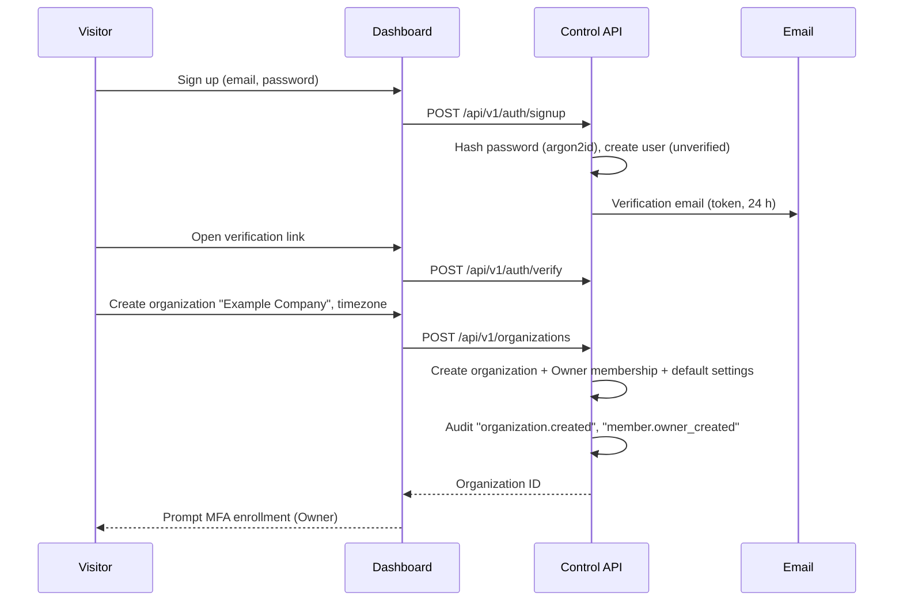

# WB-01 · Accounts, Organizations, Products and Access

| | |
|---|---|
| **Milestones** | M2 (backend), M3 (dashboard) |
| **Spec** | §2, §2.1, §6.1, §6.2, §14.3, §15.1, §18.3, §21 |
| **Plan decisions** | D7, D8; §3 sessions, invitations, auth rate limit, MFA |
| **Owners** | Backend (identity, tenancy), Frontend (auth + settings screens) |

## 1. Purpose and scope

Everything about who a user is, which organization they belong to, which products and environments they can see, and what they may do. This workbook owns the tenant boundary that every other workbook relies on.

In scope: sign-up, login, Google login (identity only), MFA, sessions, organizations, products, environments, members, invitations, roles, product scoping, audit log viewing, organization settings.

Out of scope: Google *data* access (WB-08), agent identity (WB-03).

## 2. Actors and permissions

| Actor | Description |
|---|---|
| Visitor | Not signed in |
| Owner | Created the organization; full control |
| Admin | Manages connections, members, policies |
| Operator | Day-to-day operations; limited configuration |
| Analyst | Read access, optionally limited to selected products |
| Viewer | Read-only |

Role matrix (spec §2.1, implemented exactly in `packages/tenant-security/src/role-matrix.ts`):

| Role | View | Configure connections | Manage policies | Approve actions | Manage members |
|---|---|---|---|---|---|
| Owner | Yes | Yes | Yes | Yes | Yes |
| Admin | Yes | Yes | Yes | Policy-dependent | Yes |
| Operator | Yes | Limited | Limited | Policy-dependent | No |
| Analyst | Yes, scoped | No | No | No | No |
| Viewer | Read-only | No | No | No | No |

## 3. Use cases

| ID | Use case | Actor | Trigger | Outcome |
|---|---|---|---|---|
| UC-01-01 | Sign up with email and password | Visitor | Clicks "Sign up" | Unverified user created; verification email sent |
| UC-01-02 | Sign up or log in with Google | Visitor | Clicks "Continue with Google" | User signed in; only `openid email profile` requested |
| UC-01-03 | Verify email | User | Clicks email link | Email marked verified |
| UC-01-04 | Log in with password and MFA | User | Submits login form | Session created |
| UC-01-05 | Enroll TOTP MFA | Owner/Admin | First login after role grant, or settings | MFA active; recovery codes shown once |
| UC-01-06 | Reset password | User | "Forgot password" | Password changed; all sessions revoked |
| UC-01-07 | Create organization | Verified user | First sign-in or "New organization" | Organization created; user is Owner; audited |
| UC-01-08 | Create product | Owner/Admin | "New product" | Product created with known domains and repos as hints |
| UC-01-09 | Create or edit environments | Owner/Admin | Product settings | Environment created (unique name per product) |
| UC-01-10 | Invite member | Owner/Admin | "Invite" | Expiring single-use invitation sent |
| UC-01-11 | Accept invitation | Invited person | Clicks invite link | Membership created with invited role and scope |
| UC-01-12 | Change member role or product scope | Owner/Admin | Members screen | Role/scope changed; audited |
| UC-01-13 | Remove member | Owner/Admin | Members screen | Membership removed; sessions for that org invalidated |
| UC-01-14 | Switch organization, product, environment | Any member | Context switcher | Views scoped to selection |
| UC-01-15 | View audit log | Owner/Admin | Audit screen | Filterable, append-only list |
| UC-01-16 | Log out / session expiry | User | Logout or idle 12 h / absolute 7 days | Session revoked |
| UC-01-17 | Configure organization settings | Owner/Admin | Settings | Timezone, retention, security settings saved |

## 4. Flows

### UC-01-01 + UC-01-07: Sign up and create organization



Alternate flows:
- Email already registered: respond with the same message as success ("check your email") and send a "someone tried to sign up" email. No account enumeration.
- Verification link expired: offer resend.

### UC-01-02: Google login

1. User clicks "Continue with Google".
2. API creates `state` (bound to a pre-session cookie, 10 min) and PKCE verifier; redirects with scope `openid email profile`.
3. Google returns code; API validates `state`, exchanges code, validates the ID token (`iss`, `aud`, `exp`, `email_verified=true`).
4. Existing user with that verified email → link Google identity and sign in. New → create user (verified) and continue to UC-01-07.
5. `email_verified=false` → reject with a clear message.

This login never grants data access. Connecting Google data is UC-08-01.

### UC-01-04 + UC-01-05: Login with MFA

1. User submits email and password → 10/min/IP rate limit.
2. Wrong credentials → generic error.
3. Correct, and user holds Owner or Admin in any organization:
   - MFA enrolled → ask for TOTP code (or a recovery code).
   - Not enrolled → force enrollment: show QR + secret, confirm a code, show 10 recovery codes once.
4. Session cookie `pcp_session` set (httpOnly, Secure, SameSite=Lax).

### UC-01-10 + UC-01-11: Invitation

```mermaid
sequenceDiagram
  participant O as Owner/Admin
  participant A as Control API
  participant P as Invited person
  O->>A: POST /api/v1/organizations/:orgId/invitations (email, role, productIds)
  A->>A: Check inviter may grant role; store token hash; expires 7 days
  A-->>P: Email with invitation link
  P->>A: POST /api/v1/invitations/accept (token)
  A->>A: Verify hash, unexpired, unused; signed-in email matches invite email
  A->>A: Create membership with role and product scope; mark invitation used
  A->>A: Audit "member.joined"
```

Alternate flows:
- Person has no account → sign up first, then accept.
- Signed-in email differs from invitation email → reject; offer to switch account.
- Inviter's role is lower than the invited role → 403 at creation.

### UC-01-12: Product-scoped analyst

1. Admin sets member role `analyst` with `productIds: [Product B]`.
2. That member's `TenantContext.productIds = ['<B>']`.
3. Every query joins `product_assets`/`environment_assets` (D7). FireMaps resources return 404.
4. Shared organization assets linked to Product B are visible; FireMaps-only edges are not.

## 5. Business rules

| ID | Rule |
|---|---|
| BR-01-01 | Tenant identity comes only from the server-side session; any `organizationId` in a request body is ignored or rejected. |
| BR-01-02 | Cross-tenant and out-of-scope resource access returns 404, never 403, to avoid existence leaks. |
| BR-01-03 | An organization always has at least one Owner. Removing or demoting the last Owner is rejected. |
| BR-01-04 | An inviter cannot grant a role above their own. |
| BR-01-05 | Invitations expire after 7 days and are single use; tokens are stored hashed. |
| BR-01-06 | MFA is mandatory for Owner and Admin. |
| BR-01-07 | Sessions: idle 12 h, absolute 7 days; password reset revokes all sessions. |
| BR-01-08 | Auth endpoints are rate limited to 10 requests/min/IP. |
| BR-01-09 | Environment names are unique per product. |
| BR-01-10 | Product domains and repositories are discovery hints, not proof of ownership. |
| BR-01-11 | Every mutation writes an audit event; audit rows cannot be updated or deleted by the application role. |

## 6. Data

`users`, `organizations`, `organization_members`, `role_assignments`, `sessions`, `invitations`, `products`, `environments`, `teams`, `audit_logs`. All tenant tables have RLS enabled and forced (D8).

## 7. API

Spec §15.1 routes plus identity routes (added to OpenAPI v1 in M0.4):

```http
POST   /api/v1/auth/signup
POST   /api/v1/auth/verify
POST   /api/v1/auth/login
POST   /api/v1/auth/logout
POST   /api/v1/auth/mfa/enroll
POST   /api/v1/auth/mfa/verify
POST   /api/v1/auth/password/reset-request
POST   /api/v1/auth/password/reset
GET    /api/v1/auth/google/start
GET    /api/v1/auth/google/callback
GET    /api/v1/me
POST   /api/v1/organizations
GET    /api/v1/organizations/:orgId
PATCH  /api/v1/organizations/:orgId/settings
POST   /api/v1/organizations/:orgId/invitations
POST   /api/v1/invitations/accept
GET    /api/v1/organizations/:orgId/members
PATCH  /api/v1/organizations/:orgId/members/:memberId
DELETE /api/v1/organizations/:orgId/members/:memberId
POST   /api/v1/organizations/:orgId/products
GET    /api/v1/products/:productId
POST   /api/v1/products/:productId/environments
GET    /api/v1/products/:productId/overview
GET    /api/v1/organizations/:orgId/audit-logs
```

## 8. Screens

Login, Sign up, Verify email, Reset password, MFA enrollment, Organization creation, Context switcher (org → product → environment), Products list and settings, Environments, Members and invitations, Audit log, Settings (General, Data retention, Security).

## 9. Edge cases and failure handling

| Case | Expected behavior |
|---|---|
| Same person belongs to several organizations | Context switcher lists all; each request carries one active organization |
| Concurrent role change while user is active | Next request uses new permissions (no permission cache longer than the request) |
| Invitation accepted after inviter was removed | Still valid if unexpired; audit shows original inviter |
| User loses Owner/Admin role | MFA stays enabled; not required for lower roles |
| Lost MFA device and recovery codes | Another Owner resets MFA for the user (audited); last Owner → vendor support procedure with identity verification |
| Clock drift on TOTP | Accept ±1 time step (30 s) |
| Organization timezone changed | Future reports use the new timezone; past reports unchanged |

## 10. Security and privacy

- Passwords: argon2id; never logged.
- Account enumeration avoided on sign-up, login, and reset.
- Pooled database connections never carry tenant context across transactions (Review Focus #1).
- Audit is append-only for the application role.

## 11. Test cases

| ID | Covers | Given / When / Then |
|---|---|---|
| TC-01-01 | UC-01-01 | Given an existing email, when sign-up is submitted, then the response matches a new sign-up and no second account exists |
| TC-01-02 | UC-01-02 | When Google login starts, then the authorize URL `scope` equals `openid email profile` |
| TC-01-03 | UC-01-02 | Given an ID token with `email_verified=false`, then login is rejected |
| TC-01-04 | UC-01-04 | Given 11 failed logins in 60 s from one IP, then the 11th returns 429 |
| TC-01-05 | UC-01-05 | Given an Admin without MFA, when calling any protected route, then 403 `mfa_required` |
| TC-01-06 | UC-01-07 | When an organization is created, then audit rows `organization.created` and `member.owner_created` exist |
| TC-01-07 | UC-01-10 | Given an Operator, when inviting an Admin, then 403 |
| TC-01-08 | UC-01-11 | Given an invitation used once, when accepted again, then rejected |
| TC-01-09 | UC-01-12 | Given an analyst scoped to Product B, when requesting a FireMaps asset, then 404 |
| TC-01-10 | UC-01-13 | Given one Owner, when removing them, then rejected with `last_owner` |
| TC-01-11 | BR-01-02 | Route-enumeration test: tenant B user receives 404 for every tenant A resource route |
| TC-01-12 | BR-01-11 | `UPDATE audit_logs` as `pcp_app` fails |
| TC-01-13 | Review Focus #1 | `with-tenant.int.test.ts` scenarios (plan M2.2) pass |

## 12. Task checklist

- [ ] M2.1 Database package, roles, RLS
- [ ] M2.2 Tenant context and `withTenant`
- [ ] M2.3 Authentication (password, Google login, MFA, sessions)
- [ ] M2.4 Organizations, products, environments, RBAC guard, tenant matrix test
- [ ] M2.5 Audit log
- [ ] M2.6 Members and invitations
- [ ] M3.1 Web foundation (auth pages, layout, navigation, state components)
- [ ] M3.2 Organization, product, environment, member, audit screens
- [ ] M3.3 Typed API client

## 13. Acceptance criteria

1. A new user signs up, verifies, creates "Example Company", creates FireMaps with Production and Staging, and invites a member, with every step in the audit log.
2. RLS, `with-tenant`, and tenant-matrix suites pass.
3. A product-scoped analyst cannot see another product's resources anywhere in the UI or API.

## 14. Open items

- Organization and product deletion (soft delete, grace period, data purge) is not specified in the spec. Proposed: covered by WB-17 UC-17-09 (tenant data export and deletion).
- Enterprise SSO per tenant is post-pilot backlog.
