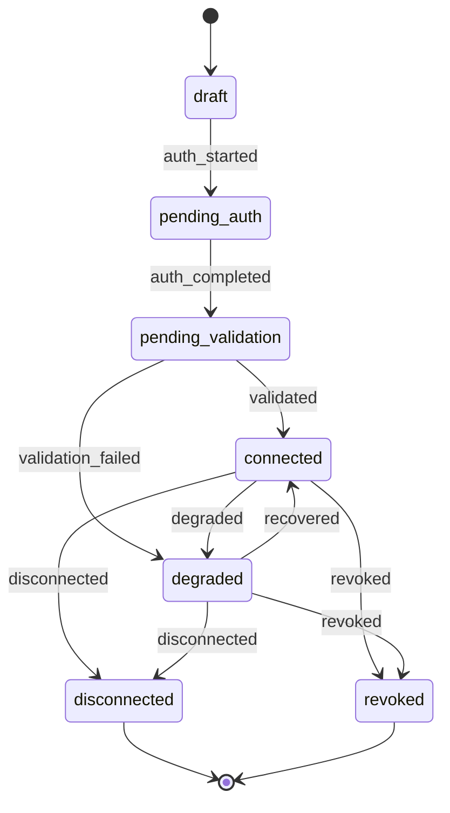

# WB-02 · Connector Framework, Connections and Secrets

| | |
|---|---|
| **Milestones** | M4 |
| **Spec** | §4.3, §4.7, §6.3, §7.1, §9, §9.1, §14.4, §15.2 |
| **Plan decisions** | D5, D9; §3 connector HTTP client, jobs |
| **Owners** | Backend |

## 1. Purpose and scope

The shared machinery every integration uses: the connector catalog, the connector SDK contract, the connection lifecycle, credential encryption, resource scoping, and background jobs for validation, discovery, and sync. Individual providers are in WB-06, WB-07, WB-08.

## 2. Actors

| Actor | Role |
|---|---|
| Admin / Owner | Creates, authorizes, scopes, and deletes connections |
| Operator | Views connections; triggers manual sync (limited configuration) |
| Analyst / Viewer | Sees connection health only |
| Connector developer | Adds a new connector package |
| Platform operator | Rotates the master key |

## 3. Use cases

| ID | Use case | Actor | Outcome |
|---|---|---|---|
| UC-02-01 | Browse connector catalog | Admin | Catalog shows each connector's capabilities, auth method, execution locations, data collected, frequency, write support |
| UC-02-02 | Create connection and choose execution location | Admin | Connection in `draft` with `cloud` or `private` location |
| UC-02-03 | Authorize connection (token or OAuth) | Admin | Credentials encrypted; status `pending_validation` |
| UC-02-04 | Validate connection | System | `connected`, or a diagnosable reason |
| UC-02-05 | Select resource scopes and assign to products/environments | Admin | `connection_resource_scopes` rows; only selected resources are monitored |
| UC-02-06 | Trigger discovery or sync manually | Admin/Operator | Job queued with deterministic ID |
| UC-02-07 | View sync history and health | Any member | Runs with status, duration, errors, rate-limit info |
| UC-02-08 | Reauthorize a degraded connection | Admin | Back to `connected` |
| UC-02-09 | Disconnect or delete connection | Admin | Sync stops; secrets destroyed; history retained |
| UC-02-10 | Rotate the master key | Platform operator | New key version; old secrets re-wrapped |
| UC-02-11 | Add a new connector package | Connector developer | Registered without changing central orchestration code |

## 4. Flows

### Connection lifecycle



Every non-`connected` status carries a reason when applicable: `reauthorization_required`, `rate_limited`, `permission_denied`, `provider_unavailable`.

### UC-02-02 → UC-02-05: Connect a provider (generic, spec §7.1)

1. Admin picks a connector and an execution location.
2. UI loads the connector's `configSchema()` and capabilities.
3. Admin fills configuration; `validateConfig` runs if declared.
4. Admin authorizes: pastes a scoped token, or completes OAuth (`beginAuthorization` → provider → `completeAuthorization`).
5. API encrypts credentials (D9) into `connection_secrets`; the token is never returned to the browser.
6. Status → `pending_validation`; job `connection-validate:<org>:<connectionId>` queued.
7. Worker runs `validate` through `ConnectorRuntime.run`, then `discover` first page to list accessible resources.
8. UI shows selectable resources; Admin assigns them to products/environments.
9. Discovery and sync schedules are created in `job_definitions` and reconciled into BullMQ.
10. Each run records `sync_runs` and `connection_health`; quota/rate-limit failures are recorded as reasons, not generic errors.

### UC-02-04: Validation job

```mermaid
sequenceDiagram
  participant Q as Queue
  participant W as Worker
  participant R as ConnectorRuntime
  participant C as Connector
  participant P as Provider API
  Q->>W: connection-validate job
  W->>R: run(ctx, connectionId, 'validate')
  R->>R: withTenant: load connection, check scope assignment
  R->>R: Decrypt credentials (AAD org:connection)
  R->>C: validate(executionContext)
  C->>P: Provider call (bounded client)
  P-->>C: Response / 401 / 403 / 429 / 5xx
  C-->>R: ConnectionValidation
  R-->>W: Result
  W->>W: transition(status, event); record health; audit
```

Response mapping:

| Provider result | Status / reason |
|---|---|
| 2xx and required permissions present | `connected` |
| 401 / invalid token | `degraded` + `reauthorization_required` |
| 403 / missing permission | `degraded` + `permission_denied` (lists missing permissions) |
| 429 | unchanged status + `rate_limited`; retry after `Retry-After` |
| 5xx / timeout / DNS | `degraded` + `provider_unavailable` after 3 retries |

### UC-02-09: Delete connection

1. Admin confirms deletion (type connection name).
2. Status → `disconnected`; schedules removed; running jobs exit at their next status check.
3. The wrapped data key is deleted (crypto-shredding); ciphertext becomes unrecoverable.
4. Assets discovered through the connection stay, marked `source disconnected`; lifecycle moves to `missing` per D4 only if another source does not keep them alive.
5. Audit `connection.deleted`.

### UC-02-10: Master key rotation

1. Operator adds `MASTER_KEY_V2` and sets the active version to 2.
2. New secrets use version 2 immediately.
3. A housekeeping job re-wraps data keys from version 1 to 2 in batches.
4. When no row references version 1, the operator removes `MASTER_KEY_V1`.

### UC-02-11: New connector

1. Create `packages/connectors/<name>/` implementing `Connector` (spec §9).
2. Declare capabilities matching implemented methods (D5); the registry rejects mismatches at boot.
3. Add contract tests over recorded fixtures and an optional nightly live test.
4. The connector appears in the catalog after deployment; central code is unchanged.

## 5. Business rules

| ID | Rule |
|---|---|
| BR-02-01 | Credentials are encrypted with AES-256-GCM envelope encryption; the key-encryption key is outside the database (`MASTER_KEY`). |
| BR-02-02 | Secrets are never returned in API responses, logs, or LLM context. |
| BR-02-03 | A connection is loaded only after verifying the authenticated context and product/resource assignment. |
| BR-02-04 | Provider resources are not automatically exposed to every product; Admin selects them. |
| BR-02-05 | A capability is declared if and only if its method is implemented. |
| BR-02-06 | Mock connectors exist only for tests and are excluded from production images. |
| BR-02-07 | HTTP client: timeout 10 s, max response 5 MB, 3 retries with jitter, honors `Retry-After`, circuit breaker per provider. |
| BR-02-08 | Jobs use deterministic IDs; 5 attempts then dead letter. |
| BR-02-09 | Missing or failed data is never stored as zero. |

## 6. Data

`connector_definitions`, `connections`, `connection_resource_scopes`, `connection_secrets`, `connection_granted_scopes`, `connection_health`, `sync_schedules`, `sync_runs`, `job_definitions`, `job_executions`.

## 7. API

Spec §15.2:

```http
GET    /api/v1/connectors/catalog
POST   /api/v1/connections
POST   /api/v1/connections/:id/authorize
GET    /api/v1/oauth/:provider/callback
POST   /api/v1/connections/:id/validate
GET    /api/v1/connections/:id/resources
POST   /api/v1/connections/:id/resource-scopes
POST   /api/v1/connections/:id/discover
GET    /api/v1/connections/:id/sync-runs
DELETE /api/v1/connections/:id
```

## 8. Screens

Integrations → Connector catalog, Connect wizard (permissions, execution location, data collected, frequency, changes supported), Resource scope selection, Connections list with status and reason, Connection detail (health, sync history, granted scopes), Reauthorize banner.

## 9. Edge cases

| Case | Expected behavior |
|---|---|
| Same provider account connected twice in one organization | Allowed; UI warns "already connected as <connection>" using provider account ID |
| Connection deleted while a job runs | Job checks status before each page and exits cleanly; partial run marked `cancelled` |
| Worker crash mid-sync | Job retries idempotently from the saved cursor; history shows the incomplete run |
| Provider returns malformed payload | Batch quarantined; sanitized diagnostics logged; status unchanged |
| Provider quota exhausted for hours | Data marked stale with banner; backoff; no zeros |
| Master key missing at startup | API refuses to start with a clear error; no partial operation |

## 10. Security

- AAD binds each secret to its organization and connection, so a ciphertext copied into another row fails to decrypt.
- Encrypted database backups are useless without the external key; key backup is a separate documented procedure (WB-17).

## 11. Test cases

| ID | Covers | Given / When / Then |
|---|---|---|
| TC-02-01 | BR-02-01 | Tampered ciphertext, tag, or AAD → decryption throws |
| TC-02-02 | UC-02-10 | Secret from key v1 decrypts after rotation to v2; re-wrap job leaves zero v1 rows |
| TC-02-03 | BR-02-02 | Response-scan test: no API response contains the seeded secret value |
| TC-02-04 | BR-02-02 | Captured logs never contain the seeded secret value |
| TC-02-05 | BR-02-03 | Running a connection owned by another organization throws `not_found` |
| TC-02-06 | Lifecycle | Illegal transition (e.g. `draft → connected`) throws |
| TC-02-07 | BR-02-05 | Registry rejects a connector declaring `sync` without `sync()` |
| TC-02-08 | BR-02-06 | Production image build fails if `connectors/mock` is present |
| TC-02-09 | BR-02-07 | Client honors `Retry-After`, stops after 3 retries, aborts over 5 MB |
| TC-02-10 | BR-02-08 | Same job ID enqueued twice runs once; 5 failures → dead letter |
| TC-02-11 | UC-02-09 | After delete, the secret cannot be decrypted and assets show `source disconnected` |

## 12. Task checklist

- [ ] M4.1 Envelope encryption
- [ ] M4.2 Connector SDK runtime
- [ ] M4.3 Connection lifecycle and registry
- [ ] M4.4 Job framework

## 13. Acceptance criteria

1. The mock connector moves `draft → connected` through the API in an integration test.
2. No secret appears in any API response or log in the full test suite.
3. Schedules survive a worker restart.

## 14. Open items

- Duplicate-connection policy (warn vs block) to confirm with product owner. Default: warn.
