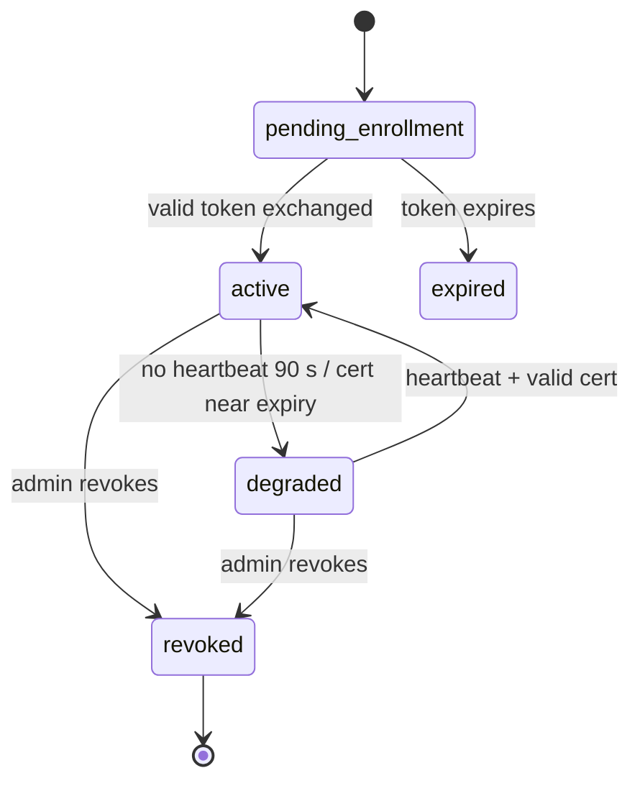
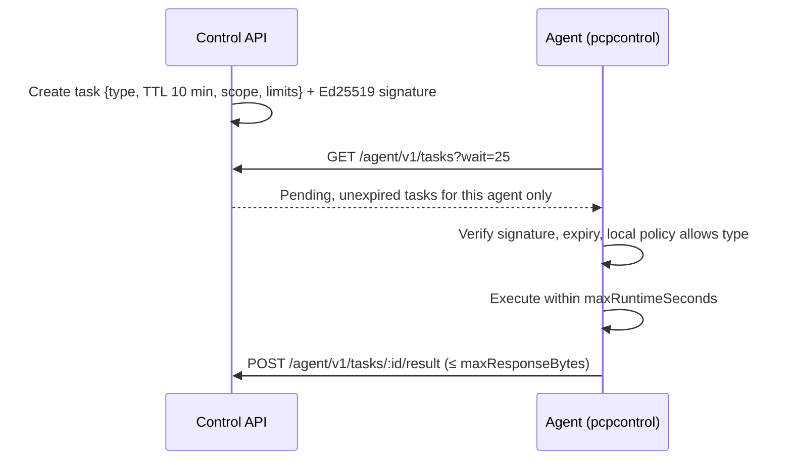

# WB-03 · Agent Enrollment, Identity and Fleet

| | |
|---|---|
| **Milestones** | M5, M6.2, M6.4, M17.1 |
| **Spec** | §4.4, §6.4, §8.2–8.5, §15.3, §16.1 |
| **Plan decisions** | D10, D11, D12, D13, D14; §3 enrollment, certificates, heartbeat, tasks, revocation |
| **Owners** | Backend (gateway), Platform (agent CLI, OpAMP) |

## 1. Purpose and scope

How an agent proves who it is, stays healthy, receives work, and is removed. Covers enrollment tokens, certificate issuance and rotation, mTLS, heartbeats, fleet status, task delivery, revocation, and upgrades. Installation methods are WB-05; what the agent collects is WB-04 and WB-11.

## 2. Actors

| Actor | Role |
|---|---|
| Admin / Owner | Creates enrollment tokens, revokes agents |
| Operator | Views fleet; triggers allowed tasks |
| Customer server admin | Runs the installer on the host |
| Agent | `pcp-agentctl`, `opampsupervisor`, `pcp-otelcol` on the host |
| Control gateway | API module handling `/agent/v1/*` |
| OpAMP server | Go service pushing configuration |

## 3. Use cases

| ID | Use case | Actor | Outcome |
|---|---|---|---|
| UC-03-01 | Create enrollment token (single host or fleet) | Admin | Token shown once; stored hashed; expiry and `max_uses` set |
| UC-03-02 | Agent enrolls | Agent | Unique agent identity; mTLS certificate; bound to org/product/environment |
| UC-03-03 | Heartbeat and status | Agent | Fleet shows `active`, `degraded`, or stale |
| UC-03-04 | Certificate rotation | Agent (timer) | New certificate before expiry; old valid 1 h |
| UC-03-05 | Revoke agent | Admin | Agent rejected within 30 s; tasks stop |
| UC-03-06 | Agent offline and recovery | Agent | Stale shown; buffered data drains on return |
| UC-03-07 | Revoked agent reconnects | Agent | 401; no tasks; no data accepted |
| UC-03-08 | View fleet and agent detail | Any member | Status, version, policy version, packs, last seen |
| UC-03-09 | Deliver a task and receive result | Control plane / Agent | Signed task executed within TTL; result stored |
| UC-03-10 | Re-enroll a reinstalled host | Admin + server admin | New identity; old agent shown as replaced |
| UC-03-11 | Upgrade agent version | Admin | Supervisor installs signed version through OpAMP |

## 4. Flows

### Agent state



### UC-03-01 + UC-03-02: Enrollment

```mermaid
sequenceDiagram
  participant AD as Admin
  participant API as Control API
  participant H as Host (pcp-agentctl)
  participant CA as Agent CA
  AD->>API: POST /api/v1/agent-enrollments (product, environment, type, max_uses, expiry)
  API-->>AD: Install command with token (shown once)
  H->>H: Generate P-256 key + CSR, X25519 key pair (keys stay on host)
  H->>API: POST /agent/v1/enroll {token, csrPem, x25519PublicKey, host facts}
  API->>API: Verify token hash, unexpired, uses < max_uses
  API->>API: Create agent bound to enrollment's org/product/environment
  API->>CA: issueAgentCertificate(csr, agentId)
  CA-->>API: certificate (CN=agentId, 30 days)
  API-->>H: agentId, certificate, chain, URLs, task-signing public key
  H->>H: Store key/cert mode 0600; start supervisor
```

Alternate flows:
- Token expired, exhausted, or unknown → identical error (no oracle).
- Payload contains `organizationId` → schema rejection.
- Host already enrolled → `pcp-agentctl enroll` refuses without `--force`.

### mTLS request path (every agent call after enrollment)

1. Agent connects to `agent.<domain>` or `ingest.<domain>` with its client certificate.
2. Caddy verifies the certificate against the agent intermediate CA and forwards `X-Client-Cert-Fingerprint`.
3. Backend accepts the header only from the Caddy network address.
4. Backend looks up the agent by fingerprint (cached ≤ 30 s), checks status ≠ `revoked`, attaches the trusted org/product/environment.

### UC-03-03: Heartbeat

- Every 30 s: `POST /agent/v1/heartbeat` with the §16 `Heartbeat` fields (`sequence`, versions, capabilities, last collection, health, queue depth, `sentAt`).
- 90 s without heartbeat → `degraded`; 5 min → stale in UI.
- `sentAt` more than 5 min off → accepted, flagged "clock skew".
- Lower `sequence` than last seen → ignored (replay).
- Agent loss alone never marks the host as down (spec §19.1).

### UC-03-04: Rotation

1. `pcp-agent-rotate.timer` runs daily; at day 20 of 30 it generates a new key and CSR.
2. `POST /agent/v1/rotate` over mTLS with the current certificate.
3. New certificate stored; old fingerprint accepted for 1 h, then rejected.

### UC-03-05 + UC-03-07: Revocation

1. Admin clicks Revoke → `POST /api/v1/agents/:id/revoke` → status `revoked`, audited.
2. Within 30 s, control gateway, OpAMP server, and ingest gateway reject the fingerprint.
3. A reconnecting revoked agent receives 401 and no tasks; its queued telemetry is rejected.
4. Admin uninstalls the agent on the host (WB-05 UC-05-07).

### UC-03-09: Task delivery



Streaming tasks (log tail, inspection) send `POST /agent/v1/streams/:sessionId/chunks` until the session ends or the TTL expires.

### UC-03-10: Re-enroll reinstalled host

1. Server admin reinstalls the OS; old agent goes stale.
2. Admin creates a new token; host enrolls as a new agent.
3. Same `machineId`/hostname as a stale agent → UI offers "replace agent X"; on confirm, old agent is revoked and asset history is linked.

### UC-03-11: Upgrade

1. Admin selects a target version (or auto-upgrade channel).
2. OpAMP server offers the signed package to the supervisor.
3. Supervisor verifies the signature, installs, restarts the collector, reports the new version.
4. Failure → supervisor keeps the previous version and reports the error.

## 5. Business rules

| ID | Rule |
|---|---|
| BR-03-01 | Enrollment tokens default to 1 h expiry (max 24 h) and `max_uses` 1; stored as SHA-256 with pepper; shown once. |
| BR-03-02 | The enrollment token is never a permanent API key; it is exchanged for a certificate. |
| BR-03-03 | Agent messages never contain tenant identifiers; the gateway resolves them from the agent record. |
| BR-03-04 | Certificates: ECDSA P-256, `CN=<agentId>`, EKU `clientAuth`, 30 days, rotated at day 20, old valid 1 h. |
| BR-03-05 | Revocation takes effect within 30 s on every gateway. |
| BR-03-06 | Expired or previously revoked tasks are never executed after reconnecting. |
| BR-03-07 | Tasks are Ed25519-signed; agents reject unsigned or tampered tasks. |
| BR-03-08 | Unsupported protocol or agent versions are rejected with an upgrade message. |
| BR-03-09 | One host may run workloads for several products; the agent's scope is its enrollment's product/environment, not host ownership. |

## 6. Data

`agent_enrollments`, `agents`, `agent_credentials`, `agent_public_keys`, `agent_policies`, `agent_heartbeats`, `agent_tasks`, `agent_task_results`, `agent_pack_assignments`.

## 7. API

```http
POST   /api/v1/environments/:environmentId/agent-enrollments
GET    /api/v1/environments/:environmentId/agent-enrollments
GET    /api/v1/agents
GET    /api/v1/agents/:id
POST   /api/v1/agents/:id/revoke
POST   /agent/v1/enroll
POST   /agent/v1/heartbeat
POST   /agent/v1/rotate
GET    /agent/v1/tasks?wait=25
POST   /agent/v1/tasks/:id/result
POST   /agent/v1/streams/:sessionId/chunks
GET    /agent/v1/opamp            (OpAMP over WebSocket, opamp-server)
GET    /internal/agents/:id/effective-config
POST   /internal/agents/:id/opamp-status
GET    /internal/agents/by-fingerprint/:fp
```

## 8. Screens

Agents → Fleet (status, version, last seen, environment, packs), Enrollment dialog (single/fleet, expiry, max uses, install command, live "waiting for agents"), Agent detail (identity, certificate expiry, heartbeats, policy version, effective config hash, tasks, revoke), Replace-agent prompt.

## 9. Edge cases

| Case | Expected behavior |
|---|---|
| Cloned VM images share `/etc/machine-id` | Identity is the certificate, not machine-id; UI warns "duplicate machine ID" |
| Leaked enrollment token | Limited by expiry and `max_uses`; Admin can revoke the enrollment; extra enrollments are visible in fleet |
| Stolen agent certificate | Admin revokes; fingerprint seen from a new source IP is logged in agent detail |
| Host clock wrong by hours | TLS may fail if outside certificate validity; heartbeat flagged; documentation tells admin to enable NTP |
| Control plane down for hours | Agent keeps collecting and buffering (WB-04); retries with backoff and jitter; no offline actions |
| Certificate expired while offline > 30 days | Agent cannot reconnect; dashboard shows "re-enrollment required"; admin re-enrolls |
| Two agents on one host | Allowed only with `--force`; warned as duplicate |

## 10. Security

- Private keys never leave the host.
- Header trust (`X-Client-Cert-Fingerprint`) is restricted to the Caddy network address.
- The root CA key is offline; only the intermediate is online.

## 11. Test cases

| ID | Covers | Given / When / Then |
|---|---|---|
| TC-03-01 | BR-03-01 | Token appears only in the creation response; DB holds only its hash |
| TC-03-02 | UC-03-02 | Expired, exhausted, and unknown tokens return the identical error |
| TC-03-03 | BR-03-03 | `EnrollRequest` with `organizationId` fails schema validation |
| TC-03-04 | BR-03-04 | Issued certificate has `CN=<agentId>`, `clientAuth`, 30-day validity |
| TC-03-05 | mTLS | Fingerprint header from a non-Caddy address is ignored |
| TC-03-06 | BR-03-05 | Revoked agent gets 401 within 30 s on control, OpAMP, and ingest |
| TC-03-07 | UC-03-03 | No heartbeat for 90 s → `degraded`; heartbeat → `active` |
| TC-03-08 | UC-03-04 | Old certificate works 1 h after rotation, then fails |
| TC-03-09 | BR-03-06 / Review Focus #2 | Offline 2 h → expired tasks not delivered; revoked while offline → nothing delivered |
| TC-03-10 | UC-03-09 | Agent B posting a result for agent A's task → 404 |
| TC-03-11 | BR-03-07 | Tampered task payload fails signature verification on the agent |
| TC-03-12 | UC-03-11 | Unsigned upgrade package is refused by the supervisor |

## 12. Task checklist

- [ ] M5.1 Agent CA and certificate issuance
- [ ] M5.2 Enrollment
- [ ] M5.3 mTLS edge and agent authentication
- [ ] M5.4 Heartbeats and fleet status
- [ ] M5.5 Tasks and streams
- [ ] M5.6 Rotation and revocation
- [ ] M5.7 Fleet UI
- [ ] M6.2 `pcp-agentctl`
- [ ] M6.4 OpAMP server and supervisor
- [ ] M17.1 Fleet install UX

## 13. Acceptance criteria

1. A Go test client enrolls, heartbeats, receives and answers a task, rotates, and is revoked.
2. Revocation blocks all three gateways within 30 s.
3. A fleet token with `max_uses=3` enrolls 3 agents and rejects a 4th.

## 14. Open items

- Auto-upgrade channels (stable/early) and their default are a product decision. Default: manual upgrades for pilot.
