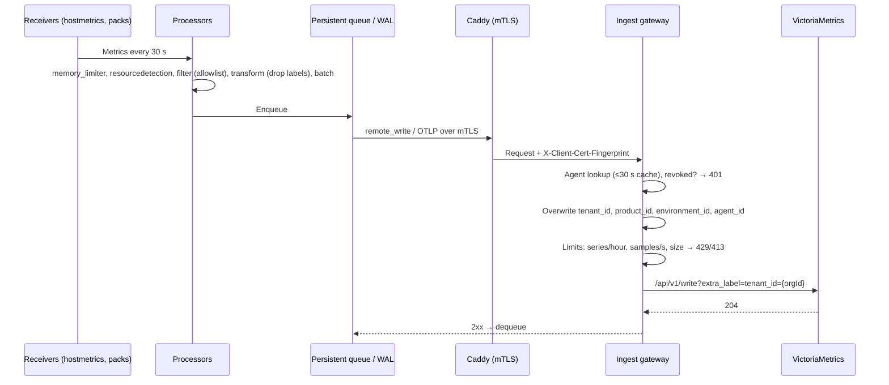

# WB-04 · Host Agent and Telemetry Pipeline

| | |
|---|---|
| **Milestones** | M6 (agent build, discovery, ingest, query, host UI) |
| **Spec** | §4.5, §4.10, §4.11, §8.5, §8.6, §11.4–11.7, §16.2, §17.3 |
| **Plan decisions** | D12, D13, D15, D16; §3 ingest limits, telemetry query, collection, storage dedup |
| **Owners** | Platform (Go), Backend (query module), Frontend (host overview) |

## 1. Purpose and scope

How metrics leave a customer host and become queryable, safely and per tenant. Covers the agent's collection and discovery, offline buffering, the ingest gateway, VictoriaMetrics storage, the tenant query layer, remote configuration through OpAMP, and the host overview screen. Service-specific packs are WB-11; logs are WB-12.

## 2. Actors

| Actor | Role |
|---|---|
| Agent (`pcp-otelcol` + `pcpcontrol`) | Collects, discovers, buffers, pushes |
| OpAMP supervisor | Applies remote configuration, restarts collector |
| Ingest gateway | Authenticates, sets tenant labels, enforces limits |
| VictoriaMetrics | Stores metrics |
| Telemetry query module | Enforces tenant/product scope on reads |
| Any member | Views host metrics |

## 3. Use cases

| ID | Use case | Outcome |
|---|---|---|
| UC-04-01 | Collect host metrics | CPU, memory, load, disk, filesystem, network every 30 s |
| UC-04-02 | Discover host facts | OS, systemd units, listening ports, containers (if enabled), processes/connections (if enabled) reported as observations |
| UC-04-03 | Push telemetry through the ingest gateway | Samples stored with trusted tenant labels |
| UC-04-04 | Buffer while offline and drain | No data loss within disk limits; no double counting |
| UC-04-05 | Enforce ingest limits | Over-limit new series rejected; existing continue; owner warned |
| UC-04-06 | Query metrics (dashboard, API, AI tools, reports) | Only caller's tenant/product data; bounded cost |
| UC-04-07 | Apply remote configuration through OpAMP | Config change live within 10 s; effective-config hash reported |
| UC-04-08 | View host overview | Charts with freshness; stale banner instead of zeros |
| UC-04-09 | Warn about publicly bound exporter | Warning on host detail and in coverage report |
| UC-04-10 | Collector crash or bad config | Supervisor keeps last good config; health reported |

## 4. Flows

### Write path (UC-04-01, UC-04-03)



### Read path (UC-04-06)

1. Dashboard / AI tool / report calls `TelemetryQueryService.query(ctx, q)`.
2. Module validates PromQL length and range (max 400 days), computes step so no series exceeds 11,000 points.
3. Adds `extra_label=tenant_id=<ctx.organizationId>`; for product-scoped roles adds `extra_filters[]` limiting `product_id`.
4. Calls VictoriaMetrics on the private network (timeout 30 s, max 1,000 series).
5. Returns `MetricResult` with `freshness`, `completeness`, and `gaps`. A range beyond raw retention returns `partial` with a gap reason, never zeros.

### Offline buffering (UC-04-04)

1. Ingest unreachable → exporters retry with exponential backoff and jitter.
2. Batches persist in `file_storage` (OTLP) and the remote_write WAL under `/var/lib/pcp-agent`.
3. Disk cap reached → oldest low-priority batches dropped; a `telemetry_dropped_total` counter and a health warning are reported on reconnect. Security-relevant audit records are never dropped silently.
4. Reconnect → backlog drains at ≤ 10,000 samples/s per agent; VictoriaMetrics deduplication (`-dedup.minScrapeInterval=1s`) prevents double counting of retried samples.

### Remote configuration (UC-04-07, UC-04-10)

1. A pack change or live boost updates the agent's desired packs in the API.
2. API compiles configuration (`compileAgentConfig`) and publishes `agent-config-changed:<agentId>`.
3. OpAMP server fetches `GET /internal/agents/:id/effective-config` and pushes it.
4. Supervisor writes the config, restarts the collector, reports status and hash.
5. Collector fails to start → supervisor reports failure and restores the last good configuration; API marks the change `failed` with the error.

### Discovery (UC-04-02, UC-04-09)

- Always: OS, kernel, architecture, hostname, machine ID, systemd units, listening sockets.
- Only when policy enables: Docker containers (through read-only socket proxy), process names and command lines, established connections.
- Never: `/proc/<pid>/environ`, application config files, `.env` files.
- Any listener on a known exporter port bound to a non-loopback address → `exporter_publicly_bound` observation → warning.

## 5. Business rules

| ID | Rule |
|---|---|
| BR-04-01 | Telemetry uses OTLP and remote_write only. |
| BR-04-02 | The gateway overwrites `tenant_id`, `product_id`, `environment_id`, `agent_id` on every sample. |
| BR-04-03 | Limits: per agent 20,000 active series/hour and 10,000 samples/s; per tenant 200,000 active series/hour; max request 10 MB decompressed. |
| BR-04-04 | Over-limit new series are rejected (429) while existing series continue; the owner is warned; nothing is dropped silently. |
| BR-04-05 | Telemetry storage is reachable only on the private network; every read goes through the query module. |
| BR-04-06 | Query limits: timeout 30 s, ≤ 1,000 series, ≤ 11,000 points per series, ≤ 400 days range. |
| BR-04-07 | Missing data is shown as missing; agent loss alone never implies host outage. |
| BR-04-08 | The agent runs as unprivileged `pcp-agent`, outbound only; no Docker socket or host root mount by default. |
| BR-04-09 | Every pipeline has `memory_limiter`; idle RSS budget < 150 MB with the host pack. |
| BR-04-10 | Samples with timestamps more than 1 h in the future are rejected by the gateway. |

## 6. Data

VictoriaMetrics series labelled with `tenant_id`, `product_id`, `environment_id`, `agent_id`; PostgreSQL `telemetry_usage`, `telemetry_limits`, `asset_observations` (discovery), `agents.effective_config_hash`.

## 7. Interfaces and endpoints

```http
POST https://ingest.<domain>/prometheus/api/v1/write
POST https://ingest.<domain>/otlp/v1/metrics
POST https://ingest.<domain>/otlp/v1/logs        (WB-12)
POST https://ingest.<domain>/otlp/v1/traces      (501 until traces ship)
POST /api/v1/metrics/query
GET  /api/v1/assets/:id/live                       (SSE, WB-11)
```

`TelemetryQueryService.query(ctx: TenantContext, q: MetricQuery): Promise<MetricResult>` (plan §4.2).

## 8. Screens

Infrastructure → Hosts list (status, CPU/memory/disk summary, last seen), Host detail (charts, discovered services, listening ports, warnings, agent health, effective config), Settings → Usage (series, samples/s, limits).

## 9. Edge cases

| Case | Expected behavior |
|---|---|
| Agent disk nearly full | Queue capped; low-priority data dropped with counter; host disk alert fires from host pack |
| Ingest returns 429 for hours | Agent backs off; dashboard shows "limit reached" with link to usage |
| Host clock skewed into the future | Samples rejected (BR-04-10); heartbeat flags skew |
| Very high-cardinality app metric | Dropped at edge if label is on drop list; else counted and limited at gateway |
| VictoriaMetrics down | Gateway returns 503; agents buffer; platform self-monitoring alerts operators |
| Collector OOM | `memory_limiter` refuses data first; supervisor restarts on crash; health shows restarts |
| Agent on arm64 | Same binary family; covered by agent end-to-end matrix |

## 10. Security

- No telemetry endpoint accepts unauthenticated data.
- Tenant labels from senders are never trusted.
- Storage ports (8428) are not exposed on the host network (Compose smoke test).

## 11. Test cases

| ID | Covers | Given / When / Then |
|---|---|---|
| TC-04-01 | UC-04-01 | After install, `system.cpu.*`, `system.memory.*`, `system.filesystem.*` series exist within 60 s |
| TC-04-02 | BR-04-02 | Agent A sends `tenant_id="B"`; stored series have `tenant_id="A"` |
| TC-04-03 | BR-04-04 | At 20,000 active series, a new series is rejected and an existing one accepted |
| TC-04-04 | UC-04-04 | Same batch replayed 3 times → sample count unchanged |
| TC-04-05 | Review Focus #2 | 2 h backlog drains at ≤ 10,000 samples/s |
| TC-04-06 | BR-04-05 | Tenant A query never returns tenant B series |
| TC-04-07 | BR-04-06 | Step is raised so no series exceeds 11,000 points |
| TC-04-08 | BR-04-07 | Range beyond retention → `completeness: 'partial'` with gap, no zeros |
| TC-04-09 | UC-04-07 | Config change reaches a connected supervisor within 10 s |
| TC-04-10 | UC-04-10 | Invalid config → supervisor restores last good config; API marks change `failed` |
| TC-04-11 | UC-04-02 | Injected filesystem proves `/proc/<pid>/environ` is never opened |
| TC-04-12 | UC-04-09 | Exporter on `0.0.0.0:9100` produces `exporter_publicly_bound` |
| TC-04-13 | UC-04-08 | Agent stopped → stale banner, no zero values on charts |

## 12. Task checklist

- [x] M6.1 Agent distribution build — M6a scope: host metrics collector, amd64/arm64 ([M6.1](../handoffs/M6.1-collector-dist.md)); size/RSS budget check in M6b
- [ ] M6.3 `pcpcontrol` extension (heartbeat, tasks, discovery) — heartbeat and tasks run in `pcp-agentctl` today; discovery in M6b
- [ ] M6.4 OpAMP server and supervisor — M6b; `pcp-agentctl` supervises the collector until then
- [x] M6.5 Ingest gateway — remote_write ([M6.5](../handoffs/M6.5-ingest-gateway.md)); OTLP in M6b/M10
- [x] M6.6 Telemetry query module ([M6.6](../handoffs/M6.6-telemetry-query.md))
- [x] M6.8 Host overview UI ([M6.8](../handoffs/M6.8-infrastructure-ui.md))

## 13. Acceptance criteria

1. On a real VPS, host metrics appear in the dashboard within 60 s of install with no inbound port opened.
2. Cross-tenant query and forged-label tests pass.
3. A 2-hour disconnect loses no data within the disk cap and causes no double counting.

## 14. Open items

- Agent disk cap default (proposed 1 GB) to confirm against small-VPS disk sizes.
