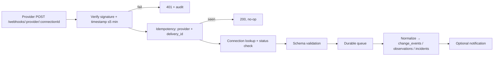

# WB-06 · Cloud Integrations: Cloudflare, GitHub, Prometheus, Grafana, Webhooks

| | |
|---|---|
| **Milestones** | M7 |
| **Spec** | §7 table, §7.1, §7.7, §11.4 (Mode A), §13.4 |
| **Plan decisions** | D5; §3 connector HTTP client, webhooks, telemetry query |
| **Owners** | Backend |

## 1. Purpose and scope

The first batch of provider connectors that run centrally (or through the private worker when the provider is internal), plus the shared webhook ingestion framework. Framework behavior (lifecycle, secrets, jobs) is in WB-02.

## 2. Actors

Admin (connects), Operator (views, manual sync), provider systems (send webhooks), worker (sync jobs).

## 3. Use cases

| ID | Use case | Outcome |
|---|---|---|
| UC-06-01 | Connect Cloudflare with a scoped API token | Token validated; zones listed for selection |
| UC-06-02 | Discover Cloudflare zones, DNS, routing, certificates, analytics | Observations and metrics stored |
| UC-06-03 | Receive Cloudflare notifications | DNS/security changes recorded as `change_events` |
| UC-06-04 | Install the GitHub App on selected repositories | Installation linked to connection |
| UC-06-05 | Discover repositories, branches, workflows, deployments, releases | Observations stored |
| UC-06-06 | Receive GitHub webhooks | Deploys, workflow failures, releases recorded |
| UC-06-07 | Connect customer Prometheus (Mode A) | Targets, metadata, rules discovered; on-demand queries |
| UC-06-08 | Map Prometheus targets to assets | `instance` → host, `job` → service, `MONITORED_BY` edges |
| UC-06-09 | Connect Grafana and link dashboards | Dashboards associated to assets; secure links |
| UC-06-10 | Ingest any provider webhook | Verified, deduplicated, normalized |
| UC-06-11 | Token revoked or permissions reduced | `reauthorization_required` or `permission_denied` with details |

## 4. Flows

### UC-06-01 + UC-06-02: Cloudflare

1. Admin creates a Cloudflare API token with the permissions below and pastes it.
2. `validate` calls Cloudflare's token verify endpoint and checks permissions.
3. `discover` lists zones; Admin selects FireMaps zones and assigns them.
4. Scheduled sync (every 6 h and on events) fetches DNS records, routing configuration, certificate status, and available analytics; security rules only where authorized.
5. Each DNS record becomes a `dns_record` observation (spec §16.3) that WB-10 correlates to hosts.

Required token permissions (read-only by default):

| Scope | Permission | Purpose |
|---|---|---|
| Zone | Zone: Read | List zones |
| Zone | DNS: Read | DNS records |
| Zone | Analytics: Read | Traffic analytics |
| Zone | SSL and Certificates: Read | Certificate status |
| Zone | Firewall Services: Read (optional) | Security events and rules |
| Zone | Cache Purge (only if purge action enabled, WB-16) | Purge |

### UC-06-04 → UC-06-06: GitHub

1. Admin clicks "Install GitHub App" → GitHub installation page → selects repositories.
2. GitHub redirects back with `installation_id`; API links it to the connection.
3. The connector mints installation tokens from the App JWT (cached until 5 min before expiry).
4. Discovery: repositories, branches, workflows, deployments, releases, relevant metadata.
5. Webhooks `push`, `workflow_run`, `deployment`, `deployment_status`, `release` arrive at `/webhooks/github/:connectionId`, verified with `X-Hub-Signature-256`.
6. A `deployment_status: success` creates a `change_events` row (used by incident correlation and reports) and `DEPLOYS` evidence (WB-10).

App permissions: Metadata (read), Actions (read), Deployments (read), Contents (read). Actions (write) only when workflow dispatch is enabled (WB-16). Repository secrets are never requested or read.

### UC-06-07 + UC-06-08: Prometheus Mode A

1. Admin enters the Prometheus URL and auth (bearer or basic), and picks central or private execution.
2. `validate` calls `/api/v1/status/buildinfo` (or a cheap query).
3. `discover` reads `/api/v1/targets`, `/api/v1/metadata`, `/api/v1/labels`, `/api/v1/rules`, `/api/v1/alerts`.
4. Each target → host observation (`instance`) and service observation (`job`) → WB-10 matches them to agent hosts by machine ID, hostname, or IP.
5. Dashboards and AI query through `query`/`query_range` with the same limits as hosted metrics. Metrics are not copied.

### UC-06-09: Grafana

Service account token → dashboards, folders, metadata. Admin links dashboards to assets; asset pages show "Open in Grafana". Grafana is never treated as metric storage.

### UC-06-10: Webhook ingestion (spec §7.7)

Only delivery metadata is stored (provider, delivery ID, event type, received time, result), not the full payload, unless a connector explicitly needs fields.

## 5. Business rules

| ID | Rule |
|---|---|
| BR-06-01 | Cloudflare tokens are scoped to selected zones; write permissions only when an action is enabled. |
| BR-06-02 | GitHub uses App installation auth on selected repositories; repository secrets are never read. |
| BR-06-03 | Prometheus Mode A never copies metrics; queries obey the hosted query limits. |
| BR-06-04 | Grafana is a link target, not a data source of record. |
| BR-06-05 | Webhooks: signature + timestamp (5 min) + idempotency (7 days); unknown connection returns the same response as a bad signature. |
| BR-06-06 | Provider data is untrusted content: it never changes system policy and is passed to AI only as data (WB-14). |

## 6. Data

`connections`, `connection_resource_scopes`, `asset_observations`, `change_events`, `webhook_deliveries`, `sync_runs`.

## 7. API

Spec §15.2 connection routes; webhook route `POST /webhooks/:provider/:connectionId`.

## 8. Screens

Integrations → Cloudflare / GitHub / Prometheus / Grafana connect wizards (permissions list, data collected, frequency, changes supported), zone and repository selection, connection detail with webhook delivery log.

## 9. Edge cases

| Case | Expected behavior |
|---|---|
| Cloudflare token lacks DNS read | `permission_denied` listing "Zone: DNS: Read" |
| GitHub App uninstalled by customer | `installation` webhook → `revoked`; sync stops; history kept |
| GitHub rate limit | `rate_limited`; respect reset header |
| Prometheus behind private network | Execution location `private` → private worker (WB-07) |
| Prometheus query too expensive | Rejected before sending, with suggestion to narrow range |
| Webhook burst (mass deploy) | Queue absorbs; processing rate-limited per tenant |
| Webhook arrives before connection is `connected` | Accepted only if status is `connected` or `degraded`; else 404 |

## 10. Test cases

| ID | Covers | Given / When / Then |
|---|---|---|
| TC-06-01 | UC-06-01 | Fixture token verify → `connected`; missing DNS read → `permission_denied` |
| TC-06-02 | UC-06-02 | Fixture zone with 3 records → 3 `dns_record` observations |
| TC-06-03 | UC-06-06 | Signed `deployment_status` → one `change_events` row; replay → still one |
| TC-06-04 | BR-06-05 | Bad signature → 401 + audit; unknown connection → identical 401 body |
| TC-06-05 | BR-06-02 | Client wrapper allowlist test: no secrets endpoint is callable |
| TC-06-06 | UC-06-08 | Target `instance="10.0.0.5:9100"` matches agent host with that IP |
| TC-06-07 | BR-06-03 | Over-limit query rejected before reaching Prometheus |
| TC-06-08 | UC-06-11 | App uninstall webhook → connection `revoked` |
| TC-06-09 | Live | Nightly live tests pass with real Cloudflare/GitHub credentials |

## 11. Task checklist

- [ ] M7.1 Webhook ingestion framework
- [ ] M7.2 Cloudflare connector
- [ ] M7.3 GitHub connector
- [ ] M7.4 Prometheus (Mode A) and Grafana connectors
- [ ] M7.5 Integrations UI

## 12. Acceptance criteria

1. Real Cloudflare, GitHub, and Prometheus connections work in staging and produce observations.
2. GitHub deploys appear as change events within 1 min of the webhook.
3. Webhook replay and forgery tests pass.

## 13. Open items

- Existing Loki/ELK log backends via connector (spec §11.8) have no task yet; proposed post-pilot (see WB-12).
