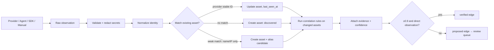
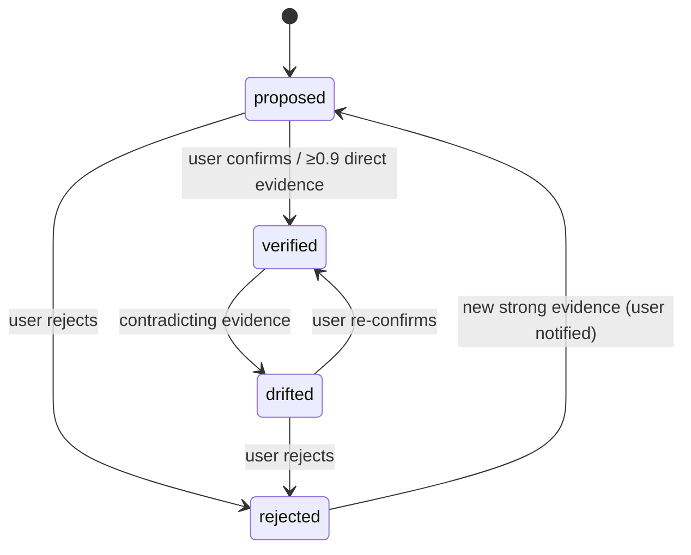

# WB-10 · Discovery and Product Knowledge Graph

| | |
|---|---|
| **Milestones** | M9 |
| **Spec** | §4.8, §6.5, §10 (all), §15.4, §16.3, §21 |
| **Plan decisions** | D3, D4, D7; Review Focus #5 |
| **Owners** | Backend (discovery engine, graph), Frontend (topology, review) |

## 1. Purpose and scope

Turning observations from connectors, agents, SDKs, and manual entry into canonical assets and evidence-backed relationships; letting people review, correct, and trust the graph; computing blast radius. The graph is the core data model of the product.

## 2. Actors

Discovery engine (system), Admin/Operator (review and correct edges), Analyst/Viewer (browse topology), AI tools and incident engine (consume graph).

## 3. Use cases

| ID | Use case | Outcome |
|---|---|---|
| UC-10-01 | Ingest an observation into a canonical asset | Asset created or updated with evidence |
| UC-10-02 | Detect a possible duplicate | Alias candidate for review; never auto-merged on name |
| UC-10-03 | Propose a relationship through a correlation rule | Edge with type, confidence, evidence, `proposed` or `verified` |
| UC-10-04 | Review, confirm, or reject an edge | Verification state updated; audited |
| UC-10-05 | Manually add an asset or edge | `manually_managed` asset or `verified` manual edge with "manual" evidence |
| UC-10-06 | Correct an edge (type or target) | Old edge rejected, new edge verified, both audited |
| UC-10-07 | Detect drift on a verified edge | State `drifted`; flagged for review; never silently deleted |
| UC-10-08 | Track asset lifecycle | `discovered → active → unreachable/missing → retired` |
| UC-10-09 | Browse topology with filters | React Flow graph by environment, type, confidence, verification |
| UC-10-10 | Analyze blast radius | Reverse traversal; confirmed/potential/unknown per dependent |
| UC-10-11 | View coverage report | Connected, discovered, verified, missing telemetry, stale, inaccessible |
| UC-10-12 | Share an asset across products | One asset linked to several products via `product_assets` |

## 4. Flows

### UC-10-01: Discovery pipeline (spec §10.1)



Identity matching order:
1. Provider stable ID scoped by connection/account (`connection_id, resource_type, external_id`).
2. Agent identity for hosts (agent ID → host asset).
3. Weak signals (hostname, IP, repository name) → alias candidate only.
Never across organizations.

### UC-10-03: Correlation rules and confidence

| Rule | Evidence | Edge | Confidence |
|---|---|---|---|
| dns-to-host | Cloudflare A/AAAA record IP = agent host IP | `ROUTES_TO` (DNS → host/service) | 0.8 |
| host-to-service | Pack detection on host | `HOSTS` (host → service) | 0.95 |
| service-connections | Established TCP from service to remote IP:port of a known service | `CONNECTS_TO` | 0.6 (0.4 if NAT/shared IP) |
| repo-to-service | GitHub deployment environment / workflow target matches service | `DEPLOYS` (repo → service) | 0.8 |
| prometheus-target | Target `instance` matches host | `MONITORED_BY` (host → Prometheus) | 0.95 |
| website-to-api | CNAME/route config, or browser SDK calls to API host | `DEPENDS_ON` (website → API) | 0.6–0.8 |
| app-to-analytics | GA4 stream URL / Firebase app ID matches app | `REPORTS_TO` | 0.95 |
| name-similarity | Names only | any | 0.3 (never auto-verified) |

### UC-10-04 → UC-10-07: Verification lifecycle



### UC-10-08: Asset lifecycle

| State | Entry condition |
|---|---|
| discovered | First observation |
| active | Observed again or has live telemetry |
| unreachable | Source reachable but asset health checks fail |
| missing | Not seen in 3 consecutive completed discovery runs of its source |
| retired | User retires it (history kept) |
| manually_managed | Created manually; not affected by discovery absence |

### UC-10-10: Blast radius (spec §10.6)

1. Start from unhealthy asset; traverse reverse dependency edges (`DEPENDS_ON`, `CONNECTS_TO`, `ROUTES_TO`, `DEPLOYED_ON`, `HOSTS`) up to depth 4 (max 6).
2. Skip `rejected` edges; weight `proposed` edges lower; respect environment.
3. Classify each dependent:
   - **confirmed**: dependent has its own active incident or failing health;
   - **potential**: reachable through verified/high-confidence edges;
   - **unknown**: reachable only through proposed or stale edges.
4. Apply product scope (D7) before returning results.

### UC-10-12: Shared asset

A VPS hosting FireMaps API and Product B worker is one asset linked to both products. Each product sees the host; each sees only its own services and edges (Review Focus #5).

## 5. Business rules

| ID | Rule |
|---|---|
| BR-10-01 | Never merge assets across organizations. |
| BR-10-02 | Never merge on name alone; weak matches become alias candidates. |
| BR-10-03 | Edges auto-verify only at ≥ 0.9 confidence with a direct observation. |
| BR-10-04 | Confirmed edges are never silently deleted; contradiction → `drifted`. |
| BR-10-05 | Every edge stores source, target, type, evidence, confidence, verification state, timestamps. |
| BR-10-06 | Product-scoped roles see only assets linked to their products (D7). |
| BR-10-07 | A dependency alone does not prove a user-visible outage. |
| BR-10-08 | Secrets in observation attributes are redacted before storage. |

## 6. Data

`assets`, `asset_aliases`, `asset_observations`, `asset_relationships`, `relationship_evidence`, `discovery_runs`, `discovery_evidence`, `product_assets`, `environment_assets`.

## 7. API

```http
GET    /api/v1/products/:id/assets
GET    /api/v1/assets/:id
GET    /api/v1/assets/:id/relationships
GET    /api/v1/assets/:id/impact
POST   /api/v1/relationships/:id/verify
POST   /api/v1/relationships/:id/reject
POST   /api/v1/relationships            (manual edge)
POST   /api/v1/assets                   (manual asset)
POST   /api/v1/assets/:id/retire
POST   /api/v1/asset-aliases/:id/resolve (merge | keep separate)
GET    /api/v1/products/:id/topology
GET    /api/v1/products/:id/coverage
```

## 8. Screens

Assets → Inventory (filter by type, lifecycle, source, environment), Discovery Review (proposed edges, alias candidates, drifted edges), Topology Graph (badges for verified/proposed/drifted, confidence, freshness), Asset detail (identity, ownership, source, last seen, freshness, relationships, health, metrics, changes, incidents, actions), Coverage report.

## 9. Edge cases

| Case | Expected behavior |
|---|---|
| Two Cloudflare accounts with the same hostname | Two DNS assets, alias candidate |
| Host IP changes (new VPS behind same DNS) | `dns-to-host` edge to old host drifts; new edge proposed |
| NAT gateway: many hosts share egress IP | Connection evidence confidence 0.4; never auto-verified |
| Very large graph (>10k assets) | Topology view paginates by product/environment and collapses clusters |
| Cycle in dependencies | Traversal tracks visited nodes; no infinite loop |
| Asset deleted at provider | `missing` after 3 runs; edges kept with stale marker |

## 10. Test cases

| ID | Covers | Given / When / Then |
|---|---|---|
| TC-10-01 | BR-10-01 | Same hostname in two orgs → two assets |
| TC-10-02 | BR-10-02 | Same name, different provider IDs → two assets + alias candidate |
| TC-10-03 | UC-10-08 | Unseen 3 completed runs → `missing` |
| TC-10-04 | BR-10-03 | Name-similarity edge never auto-verifies |
| TC-10-05 | BR-10-04 | Contradiction on verified edge → `drifted` |
| TC-10-06 | Review Focus #5 | Analyst for Product B sees shared host and B services only; impact lists only B |
| TC-10-07 | UC-10-10 | Cycle A→B→A traversal terminates; depth limit respected |
| TC-10-08 | BR-10-08 | Observation attribute with a token pattern is redacted |
| TC-10-09 | FireMaps fixture | Graph matches spec §10.5 shape |

## 11. Task checklist

- [ ] M9.1 Observation pipeline
- [ ] M9.2 Correlation rules
- [ ] M9.3 Graph API and traversal
- [ ] M9.4 Topology, inventory, review UI

## 12. Acceptance criteria

1. The FireMaps fixture produces the expected graph with evidence on every edge.
2. Manual confirm/reject/correct works and is audited.
3. Review Focus #5 test passes.

## 13. Open items

- Automatic re-proposal of rejected edges when strong new evidence appears: confirm UX with pilot users.
