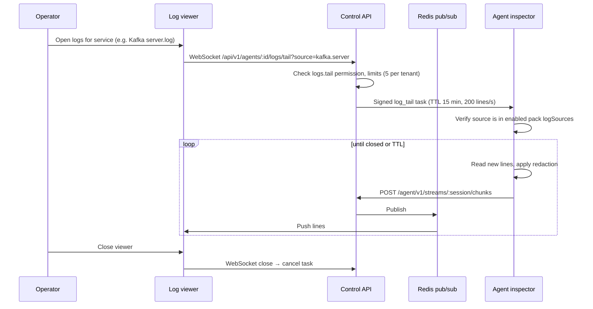

# WB-12 · Logs and Data Inspection

| | |
|---|---|
| **Milestones** | M11, M18.1, M18.2 |
| **Spec** | §11.8, §11.9, §18.2 |
| **Plan decisions** | §3 live log tail, retention |
| **Owners** | Platform (agent tail/inspector), Backend, Frontend |

## 1. Purpose and scope

Seeing service logs in real time without storing them by default, turning logs into error metrics, optional retained logs with search, and safe, audited inspection of data statistics (Redis queues, Kafka consumer groups) without reading customer data values.

## 2. Actors

Operator/Admin (tails logs, enables inspection), Owner/Admin (enables retained logs, message peek), agent inspector, ingest gateway (retained logs).

## 3. Use cases

| ID | Use case | Outcome |
|---|---|---|
| UC-12-01 | Live tail a service's logs | Redacted lines stream to the browser; nothing stored |
| UC-12-02 | Redact secrets and PII before logs leave the host | Tokens, passwords, emails, card numbers masked |
| UC-12-03 | Alert on log-derived error metrics | Error/warn/OOM/stacktrace counts as metrics; spike alert |
| UC-12-04 | Enable retained logs and search (M18) | Logs stored in VictoriaLogs with plan retention |
| UC-12-05 | Enable data inspection for a pack | Owner/Admin opt-in; audited |
| UC-12-06 | Inspect Redis | Stats, slowlog, latency, allowlisted queue depths |
| UC-12-07 | Inspect Kafka | Topics, partitions, sizes, consumer group state |
| UC-12-08 | Peek Kafka messages (opt-in) | ≤ 20 recent messages, redacted, not stored |

## 4. Flows

### UC-12-01: Live tail



Log sources per pack:

| Pack | Sources |
|---|---|
| redis | `/var/log/redis/redis-server.log` or journald unit |
| kafka | `$KAFKA_HOME/logs/server.log`, `controller.log`, `state-change.log` |
| nodejs | PM2 `~/.pm2/logs/<app>-{out,error}.log`, journald unit, Docker stdout |
| nginx | `access.log`, `error.log` |
| host | journald, `syslog`; `auth.log` opt-in only |

### UC-12-02: Redaction rules (applied on host)

| Pattern | Example | Replacement |
|---|---|---|
| Bearer / Authorization headers | `Authorization: Bearer eyJ…` | `Authorization: [REDACTED]` |
| JWT | `eyJhbGci….….` | `[JWT]` |
| Provider tokens | `ghp_…`, `sk-…`, `xoxb-…`, AWS `AKIA…` | `[TOKEN]` |
| Key-value secrets | `password=…`, `secret: …`, `api_key=…` | `password=[REDACTED]` |
| Email addresses | `user@example.com` | `[EMAIL]` |
| Card numbers (Luhn-valid 13–19 digits) | `4111 1111 1111 1111` | `[CARD]` |

### UC-12-03: Log-derived metrics

The `count` connector emits `log_lines_total{service,level}` and `log_pattern_total{service,pattern}` (`oom`, `stacktrace`) every 30 s. Default alert: error lines per minute > 5× the 1-hour baseline for 5 min.

### UC-12-06 + UC-12-07: Inspection

| Target | Allowed | Never |
|---|---|---|
| Redis | `INFO`, `DBSIZE`, `SLOWLOG GET`, `LATENCY LATEST`, `CLIENT LIST`, `MEMORY STATS`; allowlisted keys: `LLEN`, `XLEN`, `SCARD`, `ZCARD`, `MEMORY USAGE`; `SCAN` with small `COUNT`, rate-limited, off-peak | `MONITOR`, `KEYS *`, `GET`/`HGETALL`/value reads |
| Kafka | Topic list, partitions, retention config, `describeLogDirs` sizes, consumer group state and members | Reading messages (except UC-12-08 opt-in) |

### UC-12-08: Message peek

1. Owner/Admin enables peek for specific topics.
2. Operator requests a peek → audited request with reason.
3. Agent reads at most 20 latest messages, redacts, returns; nothing stored; results never go to AI.

## 5. Business rules

| ID | Rule |
|---|---|
| BR-12-01 | Live tail is default; nothing is stored. |
| BR-12-02 | Only paths from enabled packs' `logSources` can be tailed. |
| BR-12-03 | Limits: 200 lines/s per stream, 15 min, 5 concurrent per tenant. |
| BR-12-04 | Redaction happens before data leaves the host. |
| BR-12-05 | Raw logs never go to the LLM; AI gets counts and redacted samples only. |
| BR-12-06 | Data inspection is off by default, allowlisted, read-only, audited. |
| BR-12-07 | Inspection values never reach AI tools (counts and sizes only). |
| BR-12-08 | Retained logs default to 7 days and are tenant-isolated (`AccountID`/`ProjectID`). |

## 6. Data

`log_sources`, `live_sessions`, `inspection_requests`, VictoriaLogs streams (retained mode), log-derived series in VictoriaMetrics.

## 7. API

```http
GET    /api/v1/agents/:id/logs/tail          (WebSocket)
GET    /api/v1/products/:id/logs/search       (retained logs, M18)
POST   /api/v1/agents/:id/inspections
GET    /api/v1/inspections/:id
PATCH  /api/v1/agents/:id/packs/:packId/inspection   (enable/disable, peek topics)
```

## 8. Screens

Service page → Logs tab (live viewer: pause, filter, level highlight, download disabled by default), Logs search (retained), Inspection tab (Redis stats, queue depths, slowlog; Kafka topics, consumer groups, lag), Inspection settings.

## 9. Edge cases

| Case | Expected behavior |
|---|---|
| Log file rotated during tail | Tail follows new file (inode change) |
| Extremely chatty log (10k lines/s) | Rate limit 200 lines/s; UI shows "N lines skipped" |
| Agent loses connection mid-tail | Stream ends with "agent disconnected"; task expires at TTL |
| Binary or non-UTF-8 lines | Replaced with escape sequences |
| Redis big-key scan on busy server | Scheduled off-peak, rate-limited, cancellable |

## 10. Test cases

| ID | Covers | Given / When / Then |
|---|---|---|
| TC-12-01 | BR-12-02 | Tail request for `/etc/shadow` refused by agent |
| TC-12-02 | BR-12-04 | Redaction corpus fully masked in streamed output |
| TC-12-03 | BR-12-03 | Stream stops at 15 min; 6th concurrent tail rejected |
| TC-12-04 | UC-12-01 | WebSocket close cancels agent task within 5 s |
| TC-12-05 | UC-12-03 | Fixture logs produce expected `log_lines_total` counts |
| TC-12-06 | BR-12-06 | `MONITOR`, `KEYS *`, `GET` rejected |
| TC-12-07 | UC-12-08 | Peek on non-allowlisted topic refused; >20 messages capped |
| TC-12-08 | BR-12-07 | AI tool output contains no inspection values |
| TC-12-09 | BR-12-08 | Tenant A log search never returns tenant B logs |

## 11. Task checklist

- [x] M11.1 Live tail ([M11-agent-tail](../handoffs/M11-agent-tail.md), [M11-live-tail-api](../handoffs/M11-live-tail-api.md), [M11-logs-ui](../handoffs/M11-logs-ui.md))
- [x] M11.2 Log-derived metrics ([M11-log-metrics](../handoffs/M11-log-metrics.md))
- [ ] M18.1 Retained logs
- [ ] M18.2 Data inspection

## 12. Acceptance criteria

1. Live tail works for Redis, Kafka, and Node.js logs with redaction.
2. Error counts are graphed and alert on spikes.
3. Inspection tests pass behind a feature flag.

## 13. Open items

- Querying existing customer Loki/ELK backends through a connector (spec §11.8) has no task in the master plan. Proposed: post-pilot backlog item "Loki/Elasticsearch log connectors".
