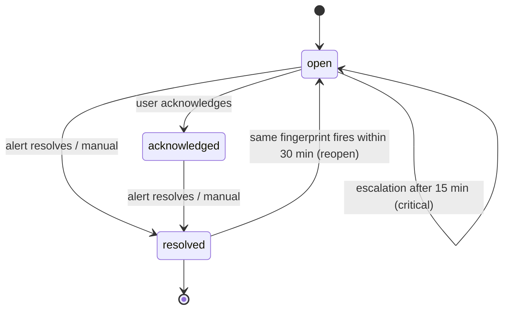

# WB-13 · Alerts, Incidents and Notifications

| | |
|---|---|
| **Milestones** | M12 |
| **Spec** | §13.1, §13.2, §13.4, inital.md §14 |
| **Plan decisions** | D17; §3 alerting |
| **Owners** | Backend, Frontend |

## 1. Purpose and scope

Detecting problems from real conditions, turning them into tenant-scoped incidents correlated through the graph, notifying the right people without noise, and tracking incidents to resolution.

## 2. Actors

Admin/Operator (rules, channels, incident handling), vmalert, worker (non-metric rules), incident engine, notification channels, on-call engineer.

## 3. Use cases

| ID | Use case | Outcome |
|---|---|---|
| UC-13-01 | Create or edit an alert rule | Rule compiled to vmalert group (metric) or worker evaluator (non-metric) |
| UC-13-02 | Metric alert fires | vmalert → Alertmanager-compatible endpoint → incident |
| UC-13-03 | Integration-failure or missing-data alert fires | Worker evaluator → incident |
| UC-13-04 | Deduplicate and correlate | One incident per fingerprint; related assets, impact, recent changes attached |
| UC-13-05 | Notify with cooldown | Email/Slack/webhook/in-app; cooldown 30 min |
| UC-13-06 | Acknowledge incident | Owner assigned; escalation stops |
| UC-13-07 | Escalate unacknowledged critical | After 15 min, escalation channel notified |
| UC-13-08 | Resolve incident | Auto when alert resolves, or manual with note |
| UC-13-09 | Configure notification channels | Email (SMTP), Slack webhook, generic webhook, in-app |
| UC-13-10 | Verify webhook signature on customer side | Documented HMAC algorithm |
| UC-13-11 | Record postmortem metadata | Summary, cause category, follow-ups linked to incident |

## 4. Flows

### Rule types

| Type | Evaluated by | Example |
|---|---|---|
| Threshold | vmalert | Redis memory > 85% of maxmemory for 10 min |
| Availability | vmalert | Website probe failing 2 consecutive checks |
| Metric change | vmalert | Error-line rate > 5× 1 h baseline for 5 min |
| Integration failure | Worker (1 min) | Connection `degraded` > 15 min |
| Missing data | Worker (1 min) | `last_successful_sync` > 3× expected interval; agent heartbeat missing |
| Deployment-related | Worker on `change_events` | Error rate rises within 30 min after a deploy |

### UC-13-01: Rule compilation (D17)

1. Admin creates rule (from pack default or custom) → `alert_rules`.
2. Compiler writes `infrastructure/telemetry/rules/tenant-<orgId>.yaml`:
   ```yaml
   groups:
     - name: tenant-<orgId>
       interval: 1m
       params:
         extra_label: ["tenant_id=<orgId>"]
       labels:
         tenant_id: "<orgId>"
       rules:
         - alert: redis-memory-high
           expr: <pack expression>
           for: 10m
           labels: { severity: warning, rule_id: "<ruleId>" }
   ```
3. vmalert reloaded with `POST /-/reload`.

### UC-13-02 → UC-13-05: Alert to notification

```mermaid
sequenceDiagram
  participant VM as vmalert
  participant API as Alert receiver
  participant IE as Incident engine
  participant G as Asset graph
  participant N as Notifications
  VM->>API: POST /internal/alertmanager/api/v2/alerts
  API->>API: Verify shared secret; tenant from labels set by compiler
  API->>IE: Normalize
  IE->>IE: Fingerprint = sha256(tenant, rule_id, sorted labels)
  IE->>IE: Existing open incident? update : create
  IE->>G: Related assets + getImpact
  IE->>IE: Attach change_events from 2 h before onset
  IE->>IE: Severity from rule; timeline event
  IE->>N: Notify unless within 30 min cooldown
  N-->>N: Email / Slack / webhook / in-app; record delivery
```

### Incident lifecycle



### UC-13-10: Webhook signature

Header: `X-PCP-Signature: t=<unix seconds>,v1=<hex>` where `v1 = HMAC-SHA256(channel secret, "<t>.<raw body>")`. Receivers reject `t` older than 5 min.

## 5. Business rules

| ID | Rule |
|---|---|
| BR-13-01 | Alerts come only from actual conditions; no synthetic incidents. |
| BR-13-02 | Deduplication is tenant-scoped and fingerprint-based. |
| BR-13-03 | Deterministic summaries say "correlated with", never "caused by". |
| BR-13-04 | Cooldown 30 min suppresses notifications, not timeline updates. |
| BR-13-05 | Critical incidents unacknowledged for 15 min escalate. |
| BR-13-06 | A tenant's rules evaluate only that tenant's series. |
| BR-13-07 | Alert evaluation continues when the AI provider is down. |
| BR-13-08 | The alert receiver endpoint is private-network only and authenticated. |

## 6. Data

`alert_rules`, `alert_incidents`, `incident_events`, `change_events`, `notification_channels`, `notification_deliveries`.

## 7. API

```http
GET    /api/v1/products/:id/alert-rules
POST   /api/v1/products/:id/alert-rules
PATCH  /api/v1/alert-rules/:id
DELETE /api/v1/alert-rules/:id
GET    /api/v1/products/:id/incidents
GET    /api/v1/incidents/:id
POST   /api/v1/incidents/:id/acknowledge
POST   /api/v1/incidents/:id/resolve
PATCH  /api/v1/incidents/:id/postmortem
GET    /api/v1/organizations/:orgId/notification-channels
POST   /api/v1/organizations/:orgId/notification-channels
POST   /api/v1/notification-channels/:id/test
POST   /internal/alertmanager/api/v2/alerts
```

## 8. Screens

Incidents & Alerts → Incident list (severity, status, product, age), Incident detail (timeline, related assets, blast radius, recent deploys, source dashboards, AI summary when available), Alert rules (pack defaults + custom), Settings → Notification channels (test button).

## 9. Edge cases

| Case | Expected behavior |
|---|---|
| Flapping alert | Reopen within 30 min reuses incident; cooldown prevents notification storm |
| vmalert down | Platform self-monitoring alerts operators; tenant dashboards still show metrics |
| Slack webhook revoked | Delivery fails 5 times → dead letter; channel marked broken; owner notified by email |
| Agent offline | "Agent heartbeat missing" alert, not "host down" |
| Many alerts from one root cause | Correlated into related incidents via graph; incident detail shows linked incidents |

## 10. Test cases

| ID | Covers | Given / When / Then |
|---|---|---|
| TC-13-01 | BR-13-06 | Two tenants' data in vmalert; tenant A rule never fires on B series |
| TC-13-02 | UC-13-03 | Sync older than 3× interval → missing-data incident |
| TC-13-03 | BR-13-02 | Duplicate alerts → one incident |
| TC-13-04 | UC-13-08 | Resolved alert → incident resolved |
| TC-13-05 | BR-13-04 | Within cooldown → no notification, timeline updated |
| TC-13-06 | BR-13-05 | Critical unacknowledged 15 min → escalation delivered |
| TC-13-07 | BR-13-03 | Deterministic summary contains "correlated with", never "caused by" |
| TC-13-08 | UC-13-10 | Documented algorithm verifies a delivered signature |
| TC-13-09 | BR-13-08 | Alert receiver unreachable from public network |

## 11. Task checklist

- [x] M12.1 Alert rules and compiler ([M12-schema](../handoffs/M12-schema.md), [M12-rule-compiler](../handoffs/M12-rule-compiler.md))
- [x] M12.2 Alert receiver and incident engine ([M12-incident-engine](../handoffs/M12-incident-engine.md), [M12-alerting-api](../handoffs/M12-alerting-api.md))
- [x] M12.3 Notifications ([M12-notifications-worker](../handoffs/M12-notifications-worker.md), [webhook signature](../integrations/webhook-signature.md))
- [x] M12.4 Incident UI ([M12-incidents-ui](../handoffs/M12-incidents-ui.md))

## 12. Acceptance criteria

1. Scenario B steps 1–3 and 6 pass (WB-18 J3).
2. Alerts are generated only from actual conditions (inital.md acceptance 14).

## 13. Open items

- On-call schedules and PagerDuty/Opsgenie integrations are post-pilot.
