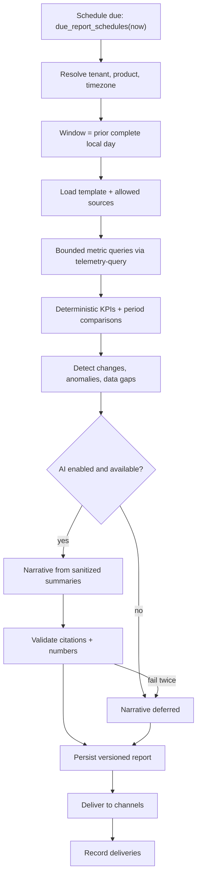

# WB-15 · Reports and Schedules

| | |
|---|---|
| **Milestones** | M15 |
| **Spec** | §12.4, §13.2, §13.3, inital.md §13 |
| **Plan decisions** | D21; §3 daily report; Review Focus #3 |
| **Owners** | Backend, Frontend |

## 1. Purpose and scope

Scheduled, evidence-backed reports: deterministic snapshots and KPIs, an AI narrative over sanitized summaries, validation of every number and citation, versioned persistence, and delivery.

## 2. Actors

Admin/Operator (configures), recipients (receive), scheduler, report generator, AI orchestrator, notification channels.

## 3. Use cases

| ID | Use case | Outcome |
|---|---|---|
| UC-15-01 | Configure a daily report | Product, environment, timezone, time, integrations, metrics, channels, recipients |
| UC-15-02 | Generate a report | Deterministic snapshot + validated narrative, versioned |
| UC-15-03 | Deliver a report | Email (HTML + text), Slack, webhook, in-app; deliveries recorded |
| UC-15-04 | View report history and versions | List, open, compare versions |
| UC-15-05 | AI provider down | Deterministic report delivered with "narrative deferred" |
| UC-15-06 | Report with missing data | "Data coverage and missing sources" section lists gaps |
| UC-15-07 | Timezone and DST handling | Prior complete local day, 23/24/25 h |
| UC-15-08 | Retry or restart without duplicates | Exactly one report per schedule per local date |
| UC-15-09 | Regenerate a report manually | New version; original kept |

## 4. Flows

### UC-15-02: Generation (spec §13.3)



Job ID: `report:<orgId>:<scheduleId>:<localDate>`.

### Report sections (inital.md §13)

1. Executive summary
2. Product health
3. Infrastructure performance
4. Application performance
5. User analytics
6. Database health
7. Advertising performance
8. Recent deployments
9. Security and availability events
10. Significant anomalies
11. Suggested actions
12. Data coverage and missing sources

Signups/authentication appear only when properly instrumented.

### UC-15-07: Window examples

| Schedule | Run at (UTC) | Window (UTC) | Local day length |
|---|---|---|---|
| 08:00 Europe/Berlin, 2026-10-26 | 2026-10-26T07:00Z | [2026-10-24T22:00Z, 2026-10-25T23:00Z) | 25 h (DST ends) |
| 08:00 Europe/Berlin, 2027-03-29 | 2027-03-29T06:00Z | [2027-03-27T23:00Z, 2027-03-28T22:00Z) | 23 h (DST starts) |
| 08:00 Asia/Karachi (no DST) | 03:00Z | prior day 19:00Z → 19:00Z | 24 h |

## 5. Business rules

| ID | Rule |
|---|---|
| BR-15-01 | Numbers are calculated deterministically; the LLM writes narrative only. |
| BR-15-02 | The LLM receives sanitized summaries only, never raw data. |
| BR-15-03 | Every number in the narrative must match the snapshot; every citation must exist. |
| BR-15-04 | One report per schedule per local date, regardless of retries or restarts. |
| BR-15-05 | Missing sources are listed; missing values are never shown as zero. |
| BR-15-06 | Reports are versioned; regeneration never overwrites. |
| BR-15-07 | Report scheduling uses `pcp_scheduler` functions, never `BYPASSRLS`. |

## 6. Data

`report_templates`, `report_schedules`, `generated_reports`, `report_deliveries`, `job_definitions`, `job_executions`.

## 7. API

```http
POST   /api/v1/report-schedules
GET    /api/v1/products/:id/report-schedules
PATCH  /api/v1/report-schedules/:id
DELETE /api/v1/report-schedules/:id
GET    /api/v1/products/:id/reports
GET    /api/v1/reports/:id
POST   /api/v1/reports/:id/regenerate
```

## 8. Screens

Reports & Schedules → Schedules (create/edit with timezone preview "next run at"), Report history, Report view (sections, citations, coverage), Delivery log.

## 9. Edge cases

| Case | Expected behavior |
|---|---|
| Worker down at 08:00 | Runs on recovery; window unchanged; delivery marked late |
| Recipient email bounces | Delivery failure recorded; owner notified after 3 consecutive bounces |
| Source connected mid-day | Coverage shows partial for that source |
| Tenant timezone changed | Next run uses new timezone; no duplicate for the transition date |

## 10. Test cases

| ID | Covers | Given / When / Then |
|---|---|---|
| TC-15-01 | Review Focus #3 | Berlin 2026-10-26 run fires at 07:00Z and covers the 25 h window |
| TC-15-02 | Review Focus #3 | Berlin 2027-03-29 run covers the 23 h window |
| TC-15-03 | BR-15-04 | Kill worker after generation, before delivery; restart → one `generated_reports` row |
| TC-15-04 | UC-15-05 | AI provider down → report delivered with "narrative deferred" |
| TC-15-05 | BR-15-03 | Narrative with a number not in snapshot → validation fails |
| TC-15-06 | BR-15-05 | Disabled source listed under coverage; no zero values |
| TC-15-07 | UC-15-09 | Regenerate creates version 2; version 1 intact |

## 11. Task checklist

- [ ] M15.1 Templates and schedules
- [ ] M15.2 Report generator
- [ ] M15.3 Delivery

## 12. Acceptance criteria

1. Daily report runs, persists, and delivers with missing-data warnings (pilot item 8).
2. Reports are timezone-correct and resilient to retries and restarts (spec §24.1).

## 13. Open items

- Weekly and monthly templates after pilot.
