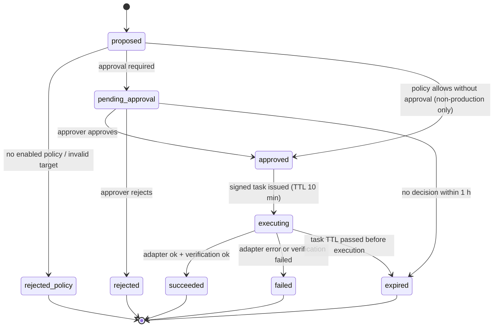

# WB-16 · Operational Actions and Approvals

| | |
|---|---|
| **Milestones** | M16, M18.3 (Level 1 pack install uses the same flow) |
| **Spec** | §13.5, §18.3, inital.md §16 |
| **Plan decisions** | D20; §3 tasks |
| **Owners** | Backend (engine, adapters), Platform (`pcp-helper`), Frontend (approvals) |

## 1. Purpose and scope

Tightly controlled operational changes: propose, check policy, dry-run, approve, execute through a restricted adapter, verify, and audit. All write capabilities are disabled by default. The AI can only propose.

## 2. Actors

| Actor | Role |
|---|---|
| Requester | User with `action.propose`, or the AI on a user's behalf |
| Approver | Role named in the action policy with `action.approve` |
| Admin/Owner | Configures action policies |
| Action engine | Policy, dry-run, signing, execution, verification |
| Adapters | Cloudflare purge, GitHub workflow dispatch, host service restart |
| `pcp-helper` | Root helper on the host, opt-in |

## 3. Use cases

| ID | Use case | Outcome |
|---|---|---|
| UC-16-01 | Configure an action policy | Action type enabled for an environment with approver roles and limits |
| UC-16-02 | Propose an action (user) | `action_requests` row in `pending_approval` or `approved` (if policy allows no approval) |
| UC-16-03 | Propose an action (AI) | Same as UC-16-02, flagged "proposed by AI", always requires approval |
| UC-16-04 | Dry-run and impact assessment | Target validation + blast radius + expected effect shown |
| UC-16-05 | Approve or reject | Decision recorded; rejection audited |
| UC-16-06 | Execute Cloudflare cache purge | Purge by URL list (purge-everything needs second approval) |
| UC-16-07 | Execute GitHub workflow dispatch | Allowlisted workflow + ref dispatched |
| UC-16-08 | Restart an allowlisted service | `pcp-helper` restarts a systemd unit from the local allowlist |
| UC-16-09 | Verify result and audit | Verification outcome recorded; incident timeline updated |
| UC-16-10 | Handle expired approval or concurrent action | Expired → re-approval; concurrent on same target → serialized |
| UC-16-11 | Install a Level 1 managed exporter | Same flow with `pack_install` capability (WB-11) |

## 4. Flows

### Request lifecycle



### UC-16-02 → UC-16-09 (spec §13.5)

```mermaid
sequenceDiagram
  participant R as Requester / AI
  participant AE as Action engine
  participant G as Asset graph
  participant AP as Approver
  participant AD as Adapter / pcp-helper
  R->>AE: POST /api/v1/actions/proposals {type, target, params, idempotencyKey}
  AE->>AE: Validate target + capability; policy/role/environment check
  AE->>G: Dry-run + impact (getImpact)
  AE-->>AP: Approval request with impact
  AP->>AE: POST /api/v1/actions/:id/approve
  AE->>AE: Approver ≠ requester (production); lock target
  AE->>AD: Signed short-lived task (Ed25519, TTL 10 min)
  AD->>AD: Verify signature, expiry, allowlist
  AD-->>AE: Execution result
  AE->>AE: Verify outcome (e.g. service active, workflow run started)
  AE->>AE: Audit + notify + incident timeline
```

### Adapters

| Adapter | Target | Allowlist | Verification |
|---|---|---|---|
| `cloudflare.purge_cache` | Selected zone | URL list (≤ 30 URLs); "everything" needs second approval | Purge API success response |
| `github.workflow_dispatch` | Selected repository | Allowlisted workflow file + ref | Workflow run created and visible |
| `host.restart_service` | Host with `pcp-helper` | systemd units in `/etc/pcp-agent/helper.yaml` (customer-controlled) | Unit `active` within 60 s |
| `host.pack_install` (M18) | Host with pack installer | Signed exporter artifacts | Exporter responds on 127.0.0.1 |

Local helper allowlist example:

```yaml
capabilities:
  service_restart:
    units: [firemaps-api.service, firemaps-worker.service]
  pack_install:
    enabled: false
```

## 5. Business rules

| ID | Rule |
|---|---|
| BR-16-01 | All action policies default to disabled. |
| BR-16-02 | The AI can only propose; AI proposals always need approval. |
| BR-16-03 | Production actions require an approver different from the requester. |
| BR-16-04 | Tasks are signed, short-lived (10 min), single use. |
| BR-16-05 | Host actions require `pcp-helper` and a customer-controlled local allowlist; the platform cannot change that allowlist. |
| BR-16-06 | One action per target at a time; requests carry idempotency keys. |
| BR-16-07 | Never assume rollback is possible; each adapter documents compensating procedures. |
| BR-16-08 | Audit records initiator, target, capability, policy decision, approver, execution location, adapter version, start/end, result, verification. |
| BR-16-09 | No arbitrary shell or AI-generated command is ever executed. |

## 6. Data

`action_policies`, `action_requests`, `action_approvals`, `action_executions`, `agent_tasks`, `audit_logs`.

## 7. API

```http
GET    /api/v1/products/:id/action-policies
PUT    /api/v1/products/:id/action-policies/:type
POST   /api/v1/actions/proposals
GET    /api/v1/actions/:id
POST   /api/v1/actions/:id/approve
POST   /api/v1/actions/:id/reject
GET    /api/v1/actions/:id/executions
```

## 8. Screens

Automations & Approvals → Policies (per environment and action type), Pending approvals (impact, dry-run, requester, AI flag), Action history, Action detail (timeline, verification, audit).

## 9. Edge cases

| Case | Expected behavior |
|---|---|
| Approval given after task TTL window | New signed task issued at approval time; old tasks never reused |
| Agent offline when task issued | Task expires after 10 min → `expired`; requester notified |
| Helper allowlist changed on host after approval | Helper checks allowlist at execution; refuses if unit removed |
| Same idempotency key resubmitted | Returns original request |
| Restart succeeds but service crashes again | Verification fails → `failed`; incident updated |
| Approver loses role before approving | Approval rejected |

## 10. Test cases

| ID | Covers | Given / When / Then |
|---|---|---|
| TC-16-01 | BR-16-01 | No policy → proposal `rejected_policy` |
| TC-16-02 | BR-16-03 | Self-approval in production rejected |
| TC-16-03 | BR-16-02 | AI proposal never auto-approved even when policy allows no approval |
| TC-16-04 | BR-16-06 | Two concurrent executions on one target serialize |
| TC-16-05 | BR-16-04 | Replayed task ID refused by helper |
| TC-16-06 | BR-16-05 | Unit not in local allowlist → helper refuses |
| TC-16-07 | UC-16-07 | Non-allowlisted workflow refused |
| TC-16-08 | UC-16-06 | Purge-everything without second approval refused |
| TC-16-09 | UC-16-09 | Verification failure → `failed` with reason |
| TC-16-10 | BR-16-08 | Audit row contains every BR-16-08 field |

## 11. Task checklist

- [ ] M16.1 Action engine
- [ ] M16.2 Adapters
- [ ] M16.3 `pcp-helper`
- [ ] M16.4 Approvals UI
- [ ] M18.3 Level 1 managed exporters (pack_install)

## 12. Acceptance criteria

1. Scenario B steps 7–8 pass (WB-18 J3).
2. Approved actions are target-scoped, time-bounded, auditable, and verified (spec §24.1).
3. Operational actions require explicit policy authorization (inital.md acceptance 18).

## 13. Open items

- Which roles approve by default per environment (spec open decision #7). Default: Owner/Admin for production, Operator for staging.
